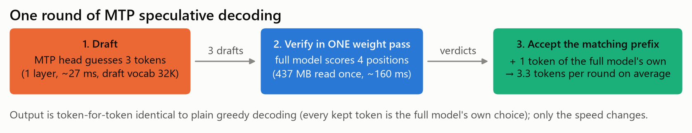

# piquant — Qwen3.5-0.8B at 16 tokens/s on a Raspberry Pi 4

**pinfer** is a C inference engine and Python package written for one board: the Raspberry Pi 4
(Cortex-A72, NEON only, 4 GB, ~4.2 GB/s of memory bandwidth). It runs the hybrid Qwen3.5-0.8B
model with its own 4-bit weight format and *exact* self-speculative decoding, and it is measured
on the real board against llama.cpp, MNN and ONNX Runtime, with every run's temperature and
throttle state recorded.

Repository: private, `github.com/Optimizer077/piquant` · engine and package: `pinfer`.

| | pinfer (Q4K) | llama.cpp Q4_K_M | MNN int4 |
|---|---|---|---|
| Decode, plain greedy | **7.9 tok/s** | 5.4 | 6.7 |
| Decode, speculative (exact) | **16.5 tok/s** | — | — |
| Prefill (prompt reading) | **37 tok/s** | 15 | 31 |
| Decode after a 4096-token context, plain | **6.4 tok/s** | 3.4 | n/a |
| Perplexity, wikitext-2 | 18.50 | 18.59 | n/a |

*Raspberry Pi 4 Model B Rev 1.1, stock Raspberry Pi OS kernel, 64-token prompt, 64 generated tokens (the
4096-token row: 32), each engine at its best thread count (4 for pinfer; MNN's 6.7 is at 2 threads, 6.3 at
4). Every number has a result file in `bench/results/`: all of them with sources in
[docs/RESULTS.md](docs/RESULTS.md).*

<picture>
  <source media="(max-width: 600px) and (prefers-color-scheme: dark)" srcset="docs/figures/decode_speed-mobile-dark.png">
  <source media="(max-width: 600px)" srcset="docs/figures/decode_speed-mobile.png">
  <source media="(prefers-color-scheme: dark)" srcset="docs/figures/decode_speed-dark.png">
  
</picture>

## Contents
1. [Why the Pi 4 is hard, and what follows from it](#1-why-the-pi-4-is-hard-and-what-follows-from-it)
2. [How pinfer works](#2-how-pinfer-works)
3. [Results](#3-results)
4. [What did not help](#4-what-did-not-help)
5. [Correctness: how we know the output is right](#5-correctness-how-we-know-the-output-is-right)
6. [Using the library](#6-using-the-library)
7. [Methodology and records](#7-methodology-and-records)
8. [Repository layout](#8-repository-layout)
9. [Status and roadmap](#9-status-and-roadmap)

## 1. Why the Pi 4 is hard, and what follows from it

Three hardware facts decided the whole design.

- **One core saturates the memory bus.** A 256 MB streaming read runs at 4.20 GB/s on one core and
  4.07 GB/s on four (`bench/memband`). Generating a token means reading *every* weight once, so decode
  speed is simply `bandwidth ÷ bytes of weights per token`. A plain decode step of the 4.5-bit model
  reads 424.9 MB (the 11.5 MB MTP head is only read when drafting), so that ceiling is about 9.9 tokens/s
  at 4.2 GB/s; nothing done on the cores can move it.
- **The Cortex-A72 has NEON but none of the newer instructions** (`asimddp` dot-product, `fp16`,
  `i8mm`). Every modern ARM inference library — llama.cpp, MNN, ONNX Runtime, LiteRT — keeps its fast
  paths behind those features and falls back to plain NEON on this chip. LiteRT-LM's prebuilt binaries
  do not run on it at all.
- **Qwen3.5-0.8B is a hybrid.** 18 of its 24 layers are Gated-DeltaNet linear attention with a fixed
  19 MB recurrent state; only 6 are full attention with a KV cache. Memory barely grows with context —
  but every token has to update that recurrent state, and the model ships a one-layer MTP draft head.

So: the only two ways past that ceiling are (a) fewer bytes per token, i.e. a quantization format that
loses no quality, and (b) producing more than one token per read of the weights — speculative decoding.
pinfer does both, and spends the rest of its effort making sure the core streams weights at the wall.

<picture>
  <source media="(max-width: 600px) and (prefers-color-scheme: dark)" srcset="docs/figures/kernel_bandwidth-mobile-dark.png">
  <source media="(max-width: 600px)" srcset="docs/figures/kernel_bandwidth-mobile.png">
  <source media="(prefers-color-scheme: dark)" srcset="docs/figures/kernel_bandwidth-dark.png">
  
</picture>

A third of those bytes is the output head — the 248K-token vocabulary times 1024, shared with the
input embedding — which is why the draft step only scores the first 32K tokens (143 MB → 19 MB).

<picture>
  <source media="(max-width: 600px) and (prefers-color-scheme: dark)" srcset="docs/figures/bytes_per_token-mobile-dark.png">
  <source media="(max-width: 600px)" srcset="docs/figures/bytes_per_token-mobile.png">
  <source media="(prefers-color-scheme: dark)" srcset="docs/figures/bytes_per_token-dark.png">
  
</picture>

## 2. How pinfer works

Diagrams of the forward pass, file format, threading and the speculative sequence, plus a source map:
[docs/ARCHITECTURE.md](docs/ARCHITECTURE.md). Unfamiliar terms: [docs/GLOSSARY.md](docs/GLOSSARY.md).

### 2.1 A weight format laid out for the A72's loads
Weights are converted once (`tools/convert.py`) into a `.pq` file: rows are tiled four at a time into
256-column superblocks, each starting with one 64-byte cache line of scales, so a thread streams one
contiguous range and every scale line lands on a cache-line boundary. Three quantized formats exist;
their quality decided the default:

<picture>
  <source media="(max-width: 600px) and (prefers-color-scheme: dark)" srcset="docs/figures/quantization-mobile-dark.png">
  <source media="(max-width: 600px)" srcset="docs/figures/quantization-mobile.png">
  <source media="(prefers-color-scheme: dark)" srcset="docs/figures/quantization-dark.png">
  
</picture>

- **Q4K** (4.5 bits/weight; asymmetric 32-column groups with 6-bit sub-scales under per-row fp16
  super-scales, llama.cpp "k-quant" style) matches Q4_K_M quality and is the shipped default.
- **Q4** (symmetric) is the same size and speed but loses 17% in perplexity — exactly like llama.cpp's
  Q4_0. The loss comes from the *layer* matrices, not the output head (measured by mixing formats).
- **Q8** is indistinguishable from bf16 (17.96 vs 17.93) at half the bytes.

Activations are quantized to int8 per 32 columns at run time; the kernels use `SMULL`/`SMLAL` into
16-bit lanes, widened into int32 with `SADALP` (one 128-bit NEON instruction per cycle on the A72, which is
why int8 beats fp32 here).

### 2.2 Kernels that run at the memory wall
Per-dtype thread policy (Q8 on one thread already saturates DRAM; Q4K needs three to keep up with
the dequantization), a pinned thread pool with ~0.3 µs dispatch, and a batched path that reads the
weights once per group of up to 16 vectors (larger batches run as groups of 16 so their int8 activations
stay in L1). Things measured and rejected: software prefetch (22% *slower* on
one thread — the hardware prefetcher already keeps up), 8-wide passes (register spills), two
accumulators per row (no gain). Lab notebook: `engine/bench/KERNELS.md`.

### 2.3 Exact speculative decoding with the model's own draft head
<picture>
  <source media="(max-width: 600px) and (prefers-color-scheme: dark)" srcset="docs/figures/speculative_schematic-mobile-dark.png">
  <source media="(max-width: 600px)" srcset="docs/figures/speculative_schematic-mobile.png">
  <source media="(prefers-color-scheme: dark)" srcset="docs/figures/speculative_schematic-dark.png">
  
</picture>

Because the Pi is bandwidth-bound, scoring four positions in one pass costs 1.24× scoring one
(160 ms vs 128 ms). Qwen3.5's MTP head drafts 3 tokens for 25–27 ms; the full model verifies all of them
in one batched pass and keeps the longest correct prefix plus one token of its own. Every kept token is
the full model's own greedy choice, so the output is token-for-token identical to plain decoding.

<picture>
  <source media="(max-width: 600px) and (prefers-color-scheme: dark)" srcset="docs/figures/mtp_acceptance-mobile-dark.png">
  <source media="(max-width: 600px)" srcset="docs/figures/mtp_acceptance-mobile.png">
  <source media="(prefers-color-scheme: dark)" srcset="docs/figures/mtp_acceptance-dark.png">
  
</picture>

Two details matter in practice. The draft step only considers the first 32,768 token ids (where
English and code live). That costs some acceptance on varied text — first-draft acceptance 87% → 76%,
2.86 → 2.37 tokens per pass at k=3 over 7 prompts (`engine/SPEC.md` §3) — but each draft becomes ~5× cheaper
and the net speed was best on all three test prompts. And rejected drafts must
roll back the 19 MB recurrent state exactly — pinfer logs each rank-1 state update during the verify
pass and replays only the accepted ones, instead of copying state.

<picture>
  <source media="(max-width: 600px) and (prefers-color-scheme: dark)" srcset="docs/figures/speculative_k-mobile-dark.png">
  <source media="(max-width: 600px)" srcset="docs/figures/speculative_k-mobile.png">
  <source media="(prefers-color-scheme: dark)" srcset="docs/figures/speculative_k-dark.png">
  
</picture>

### 2.4 Where the remaining time goes
<picture>
  <source media="(max-width: 600px) and (prefers-color-scheme: dark)" srcset="docs/figures/step_breakdown-mobile-dark.png">
  <source media="(max-width: 600px)" srcset="docs/figures/step_breakdown-mobile.png">
  <source media="(prefers-color-scheme: dark)" srcset="docs/figures/step_breakdown-dark.png">
  
</picture>

After vectorizing the recurrence (a NEON gated-delta-rule kernel, chunk-major so a 16 KB state chunk
stays in L1) and the per-token ops (norms, SiLU with a 1-ulp `exp`, RoPE, attention, argmax), a plain
step is 119 ms of weight streaming plus 10 ms of everything else — about 12% from the DRAM floor.

## 3. Results

<picture>
  <source media="(max-width: 600px) and (prefers-color-scheme: dark)" srcset="docs/figures/progress-mobile-dark.png">
  <source media="(max-width: 600px)" srcset="docs/figures/progress-mobile.png">
  <source media="(prefers-color-scheme: dark)" srcset="docs/figures/progress-dark.png">
  
</picture>

<picture>
  <source media="(max-width: 600px) and (prefers-color-scheme: dark)" srcset="docs/figures/speed_vs_quality-mobile-dark.png">
  <source media="(max-width: 600px)" srcset="docs/figures/speed_vs_quality-mobile.png">
  <source media="(prefers-color-scheme: dark)" srcset="docs/figures/speed_vs_quality-dark.png">
  
</picture>

<picture>
  <source media="(max-width: 600px) and (prefers-color-scheme: dark)" srcset="docs/figures/prefill_speed-mobile-dark.png">
  <source media="(max-width: 600px)" srcset="docs/figures/prefill_speed-mobile.png">
  <source media="(prefers-color-scheme: dark)" srcset="docs/figures/prefill_speed-dark.png">
  
</picture>

**Standard runtimes on the same board** (`bench/BASELINES.md`): MNN 3.6.1 is the strongest, 6.67 tok/s
decode and 30.9 prefill; llama.cpp v0.7.0 reaches 5.4–5.6 decode; ONNX Runtime GenAI 0.18 int4 3.1;
LiteRT-LM's prebuilt wheels abort on the A72 (they require ARMv8.2 features); PyTorch fp32 runs but
needs 4.8 GB of RAM.

### Long contexts and multi-turn chat

<picture>
  <source media="(max-width: 600px) and (prefers-color-scheme: dark)" srcset="docs/figures/context_length-mobile-dark.png">
  <source media="(max-width: 600px)" srcset="docs/figures/context_length-mobile.png">
  <source media="(prefers-color-scheme: dark)" srcset="docs/figures/context_length-dark.png">
  
</picture>

Only 6 of the 24 layers keep a KV cache (24 KB per token in fp32), so memory grows slowly: 528 MB of
RAM at 4096 tokens, 625 MB at 8192. The first sweep still lost 29% of decode speed by 4096 tokens. The
cause was not the cache's size but how it was read: the attention loop streamed a group's whole K and V
from DRAM once per query head and once per token (26.5 ms per step at 2048 tokens). The rewrite
(`engine/src/forward_attn.c`) reads each K/V row once per block of 8 tokens and shares it among the
4 query heads of its group. The arithmetic per element is unchanged, so the output is bit-identical.

| context | plain decode, fp32 / fp16 KV | prefill | speculative k=3, fixed / adaptive | llama.cpp Q4_K_M decode |
|---|---|---|---|---|
| 64 | 7.9 / 7.9 | 37 | 16.8 / 16.4 | 5.5 |
| 512 | 7.7 / 7.7 | 37 | 15.2 | 5.2 |
| 2048 | 7.1 | 32 | 9.1 / **9.6** | 4.3 |
| 4096 | 6.4 / 6.7 | 28 | 7.4 / **7.5** | 3.4 |
| 8192 | 5.3 / 5.7 | 22 | 7.2 | — |

*Tokens/s, wikitext prompt of N tokens; at 2048 and 4096 the speculative columns are the 64-token
runs. Sources: `engine/CONTEXT.md` Summary.*

- **The 4096-token target (at least 85% of short-context speed) is narrowly missed:** fp32 reaches 81%
  and fp16 84.4%. With fp32, streaming the cache alone caps it at ~84.5%, so only a smaller cache can
  get there.
- **KV cache precision is opt-in** (`kv_dtype="fp16"` / `"int8"`, `--kv-dtype`). fp16 matches fp32
  perplexity (13.983 vs 13.985 on 8 × 2048 tokens), halves the cache and is 5–8% faster from 4096
  tokens up. fp32 stays the default because fp16 changes greedy output at the first near-tie.
- **Saved state for chat and long documents.** `save_state()` / `load_state()` snapshot the KV cache and
  the recurrent state. A 2048-token context saves to 70.5 MB and restores in 0.1 s, against 63 s to
  prefill it again, and continues bit-exactly. `pinfer chat` keeps the state between turns and only reads
  the new turn: the first token of the second turn arrives after 0.7 s instead of 2.1 s.
- **Adaptive speculation** (`spec_adaptive=True`, `--adaptive`) estimates acceptance as it goes and
  lowers k, down to plain steps, when long, hard-to-predict text makes drafts a loss. Output is identical.

## 4. What did not help

Measured, logged and kept for the record:

<picture>
  <source media="(max-width: 600px) and (prefers-color-scheme: dark)" srcset="docs/figures/os_experiment-mobile-dark.png">
  <source media="(max-width: 600px)" srcset="docs/figures/os_experiment-mobile.png">
  <source media="(prefers-color-scheme: dark)" srcset="docs/figures/os_experiment-dark.png">
  
</picture>

- **A custom kernel** (6.18.50-pinfer: `NO_HZ_FULL`, isolated tickless cores 1–3, 2 MB huge pages for
  the weights) — all within 1%. The engine is DRAM-bound and the A72 already hides the page-walk cost of
  a sequential stream. The kernel is built, tested through three one-time `tryboot`s and left installed
  side by side but inactive (`os/kernel/`).
- **16 KB pages**: impossible — the Cortex-A72 has no 16 KB translation granule (Arm TRM r0p3).
- **Software prefetch, 8-wide batched passes, Q8 overrides for sensitive layers** (no quality gain over
  plain Q4K), **a Q8 output head** (−0.2 perplexity for −11% speed).

## 5. Correctness: how we know the output is right

- **Golden reference.** The official `transformers` implementation run in fp32 on the PC produces every
  layer's hidden state, the logits and a greedy continuation; the engine reproduces them with a worst
  per-layer relative error of 3e-6 and 32/32 identical tokens (`tests/test_golden.py`).
- **Bit-exactness between paths.** The batched kernel used for prefill and verification is byte-identical
  to the single-token kernel for every format and batch size (checked by `memcmp` in `engine/bench/kbench`).
  An early version was not — the two paths rounded the Q4K offset term differently — and speculative output
  diverged from plain greedy at a near-tie on one chat prompt. That bug is fixed and guarded by
  `engine/bench/spec_exact.sh` (20/20 model × prompt × k cases on the Pi).
- **The MTP wiring is verified**, not assumed: feeding the pre-norm hidden state or swapping the
  concatenation order collapses acceptance to 55% and 0.3% (figure above).
- **Quality** is measured with llama.cpp's own perplexity protocol (`engine/tools/pinfer_ppl`, cross-checked
  against `llama-perplexity` on identical text: 15.1743 vs 15.1695).
- **Validity of every speed number.** `harness/pi.py bench` records temperature, clocks and the
  firmware throttle flags before and after each run and marks the run invalid if the board throttled or
  could not report; only valid runs are quoted.

## 6. Using the library

```bash
# PC (WSL): build the engine for the Pi (NEON kernels) and convert a model
make -C engine pi MATVEC=fast
python tools/convert.py models/Qwen3.5-0.8B models/pq/qwen35-0.8b-q4k-headq4k.pq --quant q4k

# Pi: C CLI
./engine/pinfer_run -m models/qwen35-0.8b-q4k-headq4k.pq -t 4 -n 64 --ids-file data/prompt64.ids \
    --spec 3 --draft-vocab 32768 --bench

# Pi: Python package (wheel in build/dist/, install per docs/library.md)
pinfer chat -m models/qwen35-0.8b-q4k-headq4k.pq --tokenizer models/qwen35-0.8b-tokenizer \
    -p "Why is the sky blue?" --speculative --stats
```

```python
from pinfer import Model

m = Model.load("models/qwen35-0.8b-q4k-headq4k.pq", "models/qwen35-0.8b-tokenizer",
               max_ctx=8192, kv_dtype="fp16")      # fp16 cache for long contexts (default fp32)
doc = m.tokenize(open("manual.txt").read())
m.eval(doc)                                        # read a long document once ...
snapshot = m.save_state()                          # ... and keep it: restoring takes 0.1 s
for q in ("Summarize it.", "List the warnings."):
    m.load_state(snapshot)                         # back to "document read", no re-reading
    ids = doc + m.tokenize(f"\n\nQuestion: {q}\nAnswer:")   # same prefix: only the question is read
    print(m.generate(ids, speculative=True, spec_adaptive=True).text)
```

The C API (`engine/include/pinfer.h`) takes token ids and returns logits or generated ids; the Python
package adds the tokenizer, sampling, the Qwen chat template, streaming, `generate(speculative=True)`
and state snapshots.
Full guide: [docs/library.md](docs/library.md). Not published yet; no license chosen.

## 7. Methodology and records

Everything that touched the Pi went through `harness/pi.py` (check / push / run / bench / snapshot),
which appends every command to `logs/harness.jsonl`, keeps full outputs in `logs/runs/`, and serializes
benchmarks with a Pi-wide lock so parallel work never measures on top of itself.

| Question | File |
|---|---|
| What changed, when? | `CHANGELOG.md` |
| What happened on a given day, and why (problems → root cause → fix)? | `docs/journal/YYYY-MM-DD.md` |
| How does the Pi differ from stock, and how do I undo each change? | `docs/pi-state.md` |
| Every command sent to the Pi, and its output | `logs/harness.jsonl`, `logs/runs/` |
| Full Pi configuration at a point in time | `logs/snapshots/<ts>_<label>/` |
| The numbers behind every figure | `notes.md` → `bench/results/*.json` |
| How do I reproduce every number? | [`docs/REPRODUCE.md`](docs/REPRODUCE.md) |
| All results with their source files | [`docs/RESULTS.md`](docs/RESULTS.md) |
| Working rules (logging, bench lock, exactness, tests) | [`CONTRIBUTING.md`](CONTRIBUTING.md) |
| Index of all documentation | [`docs/README.md`](docs/README.md) |
| Kernel / speculation / vectorization / OS / baselines lab notebooks | `engine/bench/KERNELS.md`, `engine/SPEC.md`, `engine/CORE.md`, `os/kernel/KERNEL.md`, `bench/BASELINES.md` |

Figures are rendered from these records by `tools/make_figures.py` and `tools/make_figures2.py`.

## 8. Repository layout
```
engine/include/pinfer.h   public C API              engine/src/      loader, forward pass, MTP + speculative
engine/FORMAT.md          .pq format + exact math                     decoding, NEON kernels and per-token ops
engine/tools/             pinfer_run (CLI, bench), pinfer_ppl (perplexity)
engine/bench/             kbench, lbench, spec_exact.sh, KERNELS.md
python/                   pip package `pinfer` (ctypes, tokenizer, chat, streaming, CLI)
tools/                    convert.py, quant.py, make_figures*.py
ref/                      fp32 golden reference    tests/           golden, spec, state, Python suite (85 tests)
bench/                    llama.cpp / MNN / ORT / LiteRT / PyTorch baselines, perplexity, results/*.json
harness/pi.py             PC-side control of the Pi, auto-logged
os/stock/  os/pc/         flashing + headless first boot; direct-cable network
os/kernel/                custom split-core kernel build + tryboot scripts (built, tested, inactive)
docs/                     design, library guide, journal, pi-state, figures
```

## 9. Status and roadmap
- Done: engine, kernels, exact speculative decoding, Python package and CLI, baselines, OS experiment,
  context window (attention rewrite, fp16/int8 KV cache, state snapshots, keep-state chat, adaptive k).
- Next: engine hardening before a release (issue #11); a cheaper verify pass (#5); n-gram drafting next
  to the MTP head (#6); a bounded-context mode for unbounded chats (`engine/CONTEXT.md` §7).
- Open decisions: license; public release.
- Reproducing everything from a blank SD card / SSD: [docs/REPRODUCE.md](docs/REPRODUCE.md).
