# pinfer architecture

How the engine is built: the model it runs, which file does what, the `.pq` weight format, threads and
memory, exact speculative decoding, and the bit-exactness rules that hold it together. For *why* the
design looks like this and for the headline numbers, read the [README](../README.md) first; for the exact
math of every operation, [engine/FORMAT.md](../engine/FORMAT.md). Every fact below cites its source.

1. [The model: Qwen3.5-0.8B per token](#1-the-model-qwen35-08b-per-token)
2. [Source map and the ops.h contract](#2-source-map-and-the-opsh-contract)
3. [The .pq file and the quantized tiling](#3-the-pq-file-and-the-quantized-tiling)
4. [Threading](#4-threading)
5. [Memory budget](#5-memory-budget)
6. [Exact speculative decoding](#6-exact-speculative-decoding)
7. [Bit-exactness discipline](#7-bit-exactness-discipline)
8. [Context-window work (Phase 6)](#8-context-window-work-phase-6)
9. [Hardware](#9-hardware)

## 1. The model: Qwen3.5-0.8B per token

Dimensions as stored in the `.pq` header (`engine/FORMAT.md`; read back from
`models/pq/qwen35-0.8b-q4k-headq4k.pq`):

| Item | Value |
|---|---|
| Hidden size, FFN size, vocabulary | 1024, 3584, 248,320 (embeddings tied to the output head) |
| Layers | 24: 18 Gated DeltaNet (linear attention) + 6 gated full attention at layers 3, 7, 11, 15, 19, 23 |
| Full attention | 8 query heads, 2 KV heads (GQA 4:1), head dim 256, RoPE on the first 64 dims, θ = 1e7 |
| Linear attention | 16 heads × 128 for q, k and v; causal conv kernel 4; state 128 × 128 per head |
| Other | RMSNorm eps 1e-6, EOS id 248044, plus a one-layer MTP head (`mtp.*`) |

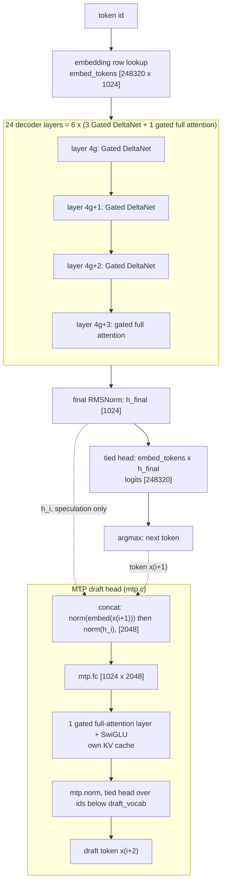

Every decoder layer is pre-norm with two residual adds (`engine/src/forward.c` `forward_chunk`).
Norm weights are stored as the effective multiplier `1 + w` (Qwen3.5 zero-centred RMSNorm), except the
gated norm inside Gated DeltaNet, which uses `w` as is (`engine/FORMAT.md`).

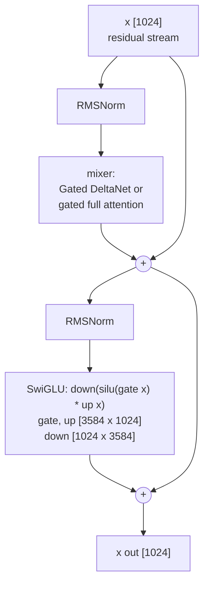

The two mixers (`engine/src/forward_lin.c`, `engine/src/forward_attn.c`; math in `engine/FORMAT.md`):

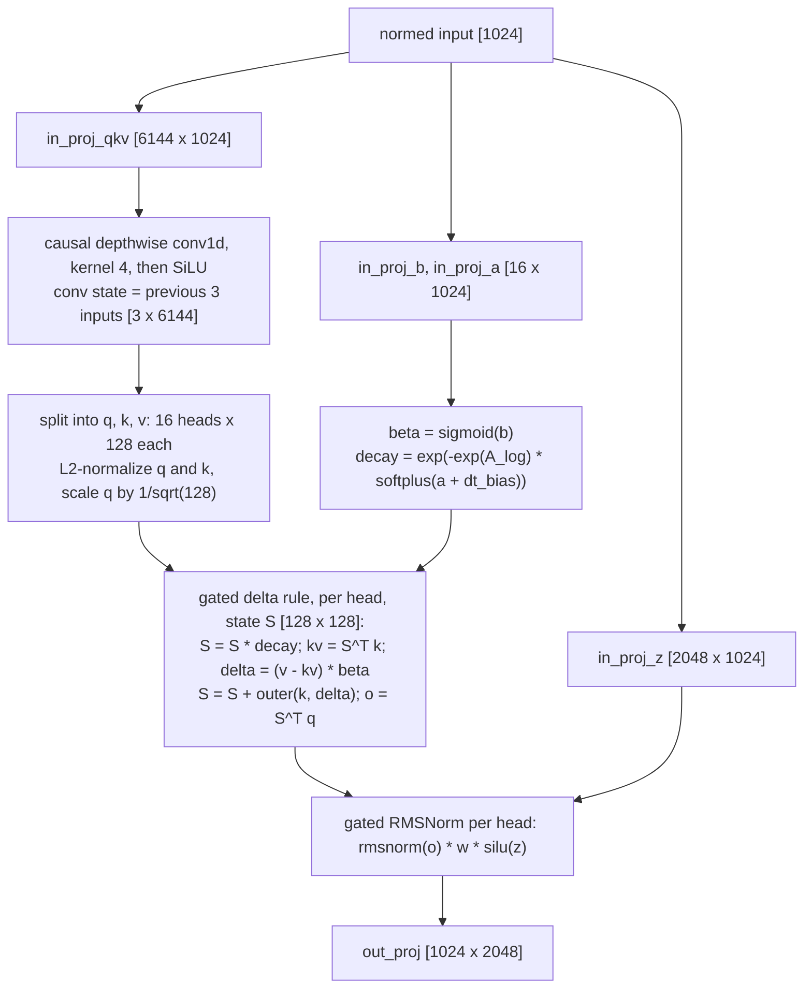

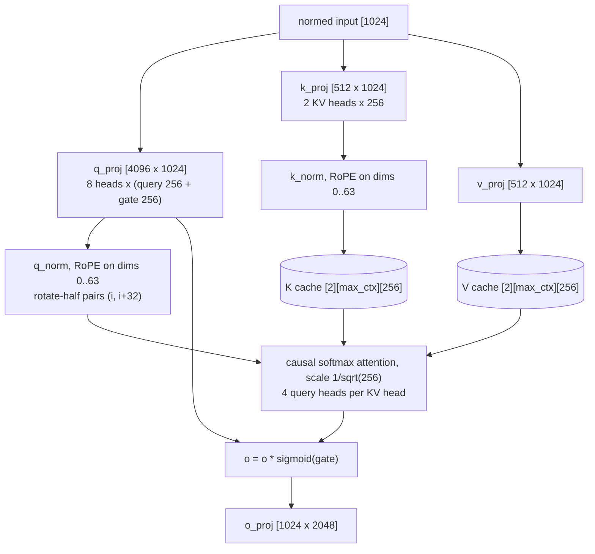

**Prefill and decode use the same code.** `pf_forward_h` cuts the input into chunks of up to
`PF_MAX_BATCH = 64` tokens. Every weight matrix is applied to the whole chunk with one `pf_matmul`,
while the sequential parts (conv state, recurrence, KV-cache attention) walk the chunk's tokens in
order (`engine/src/forward.c`, `forward.h`). Only rows whose logits are needed pay for the 248,320-row
head. Decode is the same pass with n = 1.

**MTP head.** Row i takes the main model's hidden state *after* the final norm and the token x(i+1),
and drafts x(i+2); a chained step feeds the head its own output instead of h_i. The semantics come from
vLLM and llama.cpp and were validated against a PyTorch reference: 87.3% first-draft acceptance, and
both deliberate miswirings collapse it (`engine/SPEC.md` §1, §3.1).

## 2. Source map and the ops.h contract

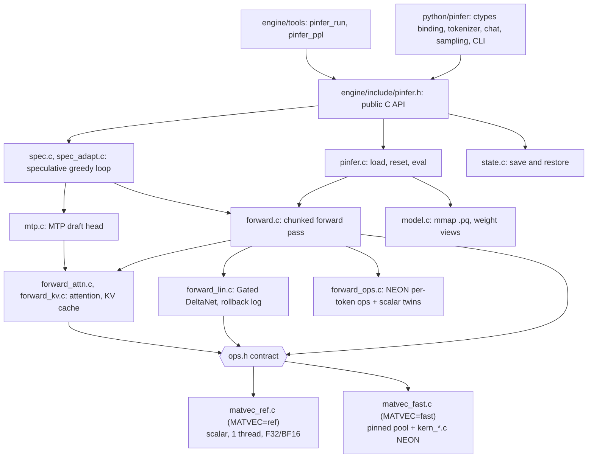

| File | Role |
|---|---|
| `engine/include/pinfer.h` | Public API: token ids in, logits or generated ids out; error codes; `pinfer_spec_params`; state save/load |
| `engine/src/pinfer.c` | `pinfer_load` (allocates all state), `pinfer_reset`, `pinfer_eval`, `pinfer_argmax` |
| `engine/src/model.c`, `model.h` | `mmap` the `.pq` file, strict validation, per-layer weight views; opt-in `PINFER_HUGEPAGES` copy |
| `engine/src/pq_format.h`, `pq_quant.h` | On-disk header and directory structs; quantized dtype ids and superblock sizes |
| `engine/src/forward.c`, `forward.h` | Chunked forward pass (`pf_forward`, `pf_forward_h`), MLP, norms, RoPE tables; the `pinfer_ctx` struct |
| `engine/src/forward_lin.c` | Gated DeltaNet mixer; rollback log (`pf_lin_log_alloc`, `pf_lin_commit`) |
| `engine/src/forward_attn.c`, `forward_kv.c` | Gated full attention in blocks of 8 tokens; KV rows as fp32 / fp16 / int8; `pf_dot4`, `pf_attn_pv_acc` |
| `engine/src/forward_ops.c` | exp, SiLU, sigmoid, RMSNorm, L2 norm, conv, RoPE, dot, softmax, argmax: NEON bodies with bit-identical scalar mirrors |
| `engine/src/forward_stats.c`, `kern_stats.c` | Opt-in profiles: `PF_FWD_STATS=1` (per phase), `PF_KERN_STATS=1` (per matmul shape) |
| `engine/src/mtp.c`, `mtp.h` | Maps `mtp.*` tensors, owns the MTP KV cache, runs the draft head |
| `engine/src/spec.c`, `spec.h`, `spec_adapt.c` | Draft / verify / accept / commit loop; `pinfer_generate_greedy*`; adaptive-k policy |
| `engine/src/state.c` | `pinfer_state_size/save/load` |
| `engine/src/ops.h` | The only interface between model code and matrix kernels (below) |
| `engine/src/matvec_ref.c` | Scalar reference of `ops.h`: F32/BF16 only, single thread, fixed summation order |
| `engine/src/matvec_fast.c`, `kern.h` | Pinned thread pool, dispatch, per-dtype thread policy, activation quantization, prefill grouping |
| `engine/src/kern_float.c`, `kern_quant.c`, `kern_act.c` | NEON F32/BF16 kernels; Q8_G32 / Q4_G32 / Q4K_G32 kernels (`SMULL`/`SMLAL`); int8 activation quantization |
| `engine/src/kern_lin.c` | NEON Gated DeltaNet recurrence and commit replay, threaded over heads |
| `engine/tools/pinfer_run.c`, `pinfer_ppl.c` | CLI (`--bench` prints a `RESULT {json}` line); llama-perplexity-compatible perplexity |
| `engine/bench/` | `kbench` (kernels, exactness), `lbench` (recurrence), `ubench` (A72 instruction costs), `spec_exact.sh`, `core2_check.sh`, `ctx_check.sh` |
| `engine/pkg/` | Linker version script (exports `pinfer_*` only), `pinfer.pc.in`, `check_lib.sh` |
| `tools/convert.py`, `tools/quant.py` | Hugging Face safetensors → `.pq`; reference quantizers, packers, error report, kbench golden file |
| `python/pinfer/` | `_lib.py` (find and type `libpinfer.so`), `model.py`, `speculative.py`, `tokenizer.py`, `chat.py`, `sampling.py`, `streaming.py`, `cli.py`, `convert.py`, `errors.py` |
| `ref/`, `tests/` | fp32 golden-data generators (output in gitignored `ref/golden/`); host tests `test_golden.py`, `test_spec.py`, `test_state.py`; `tests/python` pytest suite |

**The ops.h contract** (`engine/src/ops.h`). The model code calls only these functions. The build picks
one implementation: `make -C engine MATVEC=ref|fast` links `matvec_ref.c`, or `matvec_fast.c` plus every
`kern_*.c` (`engine/Makefile`; the default is `ref`).

| Function | Contract |
|---|---|
| `pf_matvec(pool, W, x, y)` | `y = W x` for one vector |
| `pf_matmul(pool, W, X, Y, n)` | n vectors at once; row v of the result must equal `pf_matvec` on vector v bit for bit (§7) |
| `pf_lin_rule(pool, args)` | Gated DeltaNet recurrence of one layer over n tokens, exact per-element fp32 operations, no FMA; first applies `keep` deferred updates (`pend`); with `log != NULL` only token 0 updates the state, tokens 1.. run on a copy and write `k, delta, decay` per (token, head) |
| `pf_lin_apply(pool, S, log, keep, ...)` | Commit replay of the first `keep` logged updates |
| `pf_pool_run(pool, fn, arg, max)` | Generic parallel job; the split must not change any per-element arithmetic |
| `pf_get_row`, `pf_dtype_supported` | Embedding lookup (dequantized row); dtype support of this build |

`matvec_ref.c` supports only F32 and BF16, so a ref build loads only `bf16` `.pq` files (`model.c`
rejects other dtypes with `PINFER_E_FORMAT`). `matvec_fast.c` does not compile on x86 (aarch64 `yield`
asm, `engine/SPEC.md` §6): the fast kernels run on the Pi or under `qemu-aarch64`. The x86-64 wheel
therefore carries the ref kernels (`docs/library.md`).

## 3. The .pq file and the quantized tiling

One file per model, little-endian, written by `tools/convert.py`, mapped read-only by
`engine/src/model.c` (format v1, `engine/FORMAT.md`, structs in `engine/src/pq_format.h`).

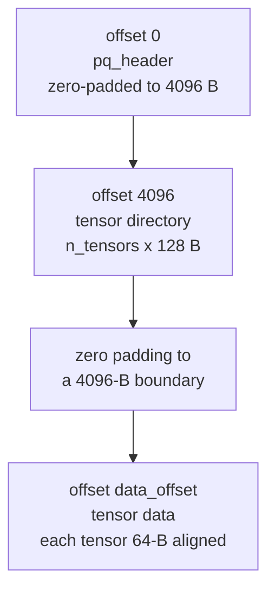

- The Q4K default file has 335 tensors and `data_offset` 49,152: 195 quantized matrices (434.4 MB),
  140 F32 tensors (2.0 MB). The tied embedding/head is 143.0 MB of it, the MTP head 11.5 MB (read back
  from the file's directory).
- Directory entry: `name[80]`, `dtype`, `ndim`, `shape[4]`, `offset`, `nbytes`, 8 reserved bytes.
  Matrices are row-major with `shape[0]` = output rows, so `y = W x` reads rows contiguously.
- `model.c` checks magic, version, architecture, every dimension, bounds and 64-byte alignment of every
  tensor, so a truncated copy fails at load with `PINFER_E_FORMAT`.
- Names drop the HF prefix `model.language_model.`; vision tensors are not stored; `mtp.*` keeps its name.

**Quantized tiling** (`engine/FORMAT.md` "Quantized dtypes", `engine/src/pq_quant.h`). Rows are taken
4 at a time (a tile); each tile is a run of 256-column superblocks; a superblock is one 64-byte scale
line followed by the codes of eight 32-column blocks, block after block, row 0..3 inside a block. The
superblock size is a multiple of 64, so each scale line starts a cache line and each thread streams one
contiguous byte range (requires `rows % 4 == 0`, `cols % 256 == 0`, true for every Qwen3.5 matrix).

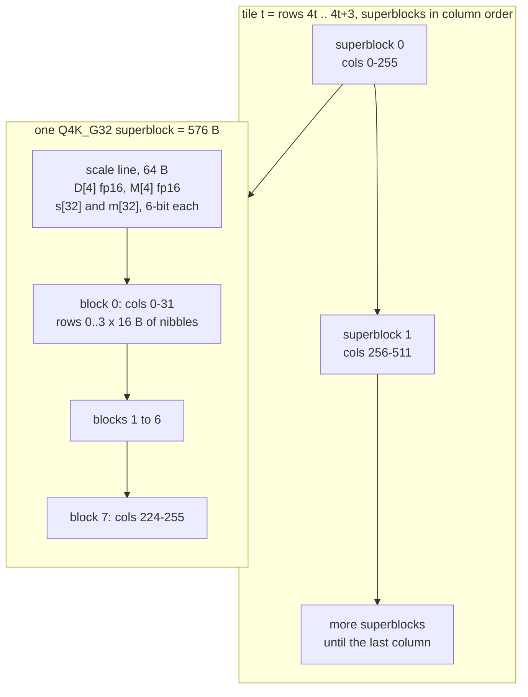

| id | dtype | bits/weight | superblock | scale line | weight value |
|---|---|---|---|---|---|
| 0 / 1 | F32 / BF16 | 32 / 16 | (row-major, not tiled) | — | as stored |
| 2 | Q8_G32 | 8.5 | 1088 B | fp16 `d` per 32 columns and row | `d · q`, q ∈ [−127, 127] |
| 3 | Q4_G32 | 4.5 | 576 B | fp16 `d` per 32 columns and row | `d · (u − 8)`, u ∈ [0, 15] |
| 4 | Q4K_G32 | 4.5 | 576 B | per row: fp16 `D`, `M`; per 32 columns: 6-bit `s`, `m` | `D·s·u − M·m` (k-quant style, asymmetric) |

At run time the kernels quantize activations to int8 per 32 columns (scale = absmax/127) and multiply
with `SMULL`/`SMLAL` into int16 lanes, reduce the 4 rows of a tile into one int32x4 (lane = row), and
convert once per block (`engine/src/kern_quant.c`, `kern_act.c`). Why int8: the A72 retires 8 int8 MACs
per cycle with `SMULL`/`SMLAL` but 4 fp32 MACs with `FMLA` (`engine/bench/KERNELS.md`, ubench table).

## 4. Threading

| Aspect | Behaviour | Source |
|---|---|---|
| Pool | `n_threads` threads (default 4, at most the CPUs in the caller's mask): workers 1..n−1 are pinned to the 2nd..n-th CPU of the caller's mask (CPUs 1..n−1 normally); the calling thread does worker 0's share and is not pinned (until 0.1.0 it was pinned to CPU 0, which every thread the application created later inherited; `engine/HARDENING.md` H4) | `matvec_fast.c` `pf_pool_create` |
| Dispatch | Publish the job, bump a generation counter (the futex word), wake sleepers, run worker 0's share on the caller, spin until all are done | `dispatch()` |
| Idle workers | Spin up to 50 ms (`SPIN_SEC`), then sleep on the futex: a decode step issues ~150 matmuls back to back | `worker_main()` |
| Dispatch cost | Empty job: 11 / 238 / 369 / 478 ns for 1 / 2 / 3 / 4 threads | `engine/bench/KERNELS.md` v9 |
| Matmul split | One contiguous slab of 4-row tiles per thread: one sequential DRAM stream each | `run_job()` |
| Threads per matmul | n = 1: at most F32 2, BF16 2, Q8 1, Q4 3, Q4K 3; batched calls use all threads; at least 32 KB of weights per thread | `threads_for()`, KERNELS.md v9-auto / v10 |
| Prefill batches | n > 16 runs in groups of 16 vectors; each group re-streams the weights so its int8 activations stay in L1 (−9% on the big prefill matmuls) | `pf_matmul`, KERNELS.md v13 |
| Other parallel work | `pf_pool_run`: attention (KV group × row half, then KV group × head half), conv channel ranges in multiples of 128, gated-norm heads, MLP activation slices; recurrence over the 16 heads | `forward_*.c`, `kern_lin.c`, `engine/CORE.md` round 2 |
| Ref build | Stub pool: everything runs on the calling thread | `matvec_ref.c` |

The per-dtype caps follow from the memory wall: one core already streams Q8 at 4.23–4.33 GB/s (the
DRAM limit) and extra streams cost 3–10%, while Q4/Q4K decoding needs about 40–47 cycles per 64 bytes on
one core and reaches the wall only with 2–3 threads; a cap of 3 measured 3–7% faster than 4
(`engine/bench/KERNELS.md` "Best kernel per dtype", v9-auto / v10). Isolating cores 1–3 with a custom
kernel changed decode by less than 1% (`os/kernel/KERNEL.md`, `notes.md`).

## 5. Memory budget

Q4K default model, fp32 KV cache. Sizes follow from the allocation code; measured RSS is from
`bench/results/pinfer-final2-q4k_20261022_023950.json` and `engine/CONTEXT.md` §3.

| Item | Size | When allocated | Source |
|---|---|---|---|
| Weights | 436.5 MB file, `mmap(PROT_READ, MAP_PRIVATE)`, no copy; shared through the page cache. A plain decode step streams 424.9 MB of it: everything except the 11.5 MB MTP head | `pinfer_load` | `model.c`, `.pq` directory |
| Recurrent state | 18 layers × 16 heads × 128 × 128 × 4 B = 18.9 MB | `pinfer_load` (zeroed) | `pinfer.c` |
| Conv state | 18 × 3 × 6144 × 4 B = 1.3 MB | `pinfer_load` | `pinfer.c` |
| KV cache, main | 6 layers × (K + V) × 2 heads × 256 × 4 B = 24 KiB per token; 96 MiB at `max_ctx` 4096 | `pinfer_load`, `calloc` for the full `max_ctx`; measured RSS grows only with the context actually used (last row) | `pinfer.c`, `forward_kv.c` |
| KV cache, MTP | 4 KiB per token (16 MiB at 4096) | first speculative call | `mtp.c` |
| Scratch | 64-row activation buffers, ~4 MB; attention scores 8 tokens × 8 heads × `max_ctx` floats (1 MiB at 4096) | `pinfer_load` | `pinfer.c`, `forward.h` |
| Speculation | verify logits (k+1) × 248,320 floats (~4 MB at k = 3); rollback log (k+1) × (6144 + 16 × 257) floats per linear layer (~3 MB over 18 layers at k = 3) | first speculative call | `spec.c`, `forward_lin.c` |
| Measured peak RSS | 433.0 MB plain, 451.7 MB speculative k = 3 (64-token prompt); 528 / 562 MB at a 4096-token prompt | | result files above |

`PINFER_HUGEPAGES=1` copies the weights into an anonymous THP mapping, which doubles their footprint
(peak RSS 833–837 MB in `bench/results/pinfer-k3b-thp-q4k_20261022_013420.json`) and did not speed
anything up (`notes.md` "Custom kernel").

## 6. Exact speculative decoding

The Pi is bandwidth-bound, so checking several positions in one pass over the weights costs little
more than one: a verify pass of 4 positions takes 162 ms against 127 ms for a plain step
(`pinfer-final2-q4k_20261022_023950.json`). One round (`engine/src/spec.h`, `spec.c`):

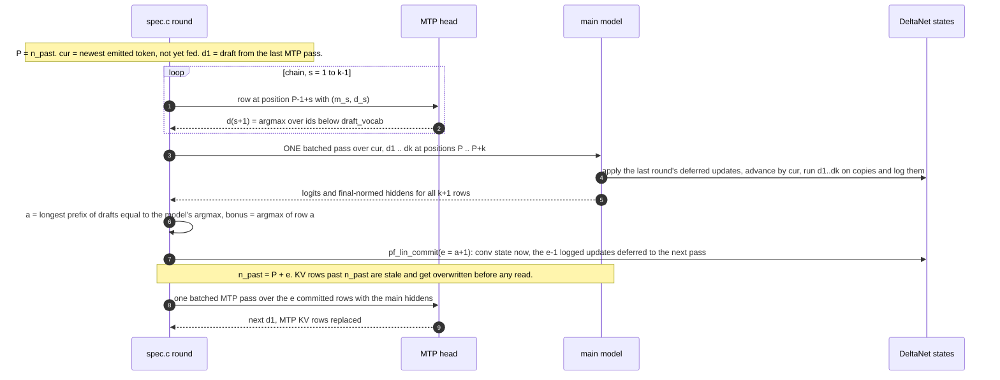

**Why the output equals plain greedy decoding.**
1. Every emitted token is the main model's argmax at its position. A draft only decides how many
   positions one pass can confirm.
2. Row j of the verify pass sees the committed history plus `cur, d1..dj`. While drafts are accepted they
   equal the model's own greedy tokens, so the row's input is exactly what plain decoding would feed.
3. The batched pass computes every row bit-identically to a single-token step (§7), so the logits, and
   therefore the argmax, are the same as in plain decoding, near-ties included.
4. Rejected work leaves no trace. KV rows past `n_past` are rewritten before any query can read them,
   because `pf_full_attn` stores a chunk's K/V before attending and attention is causal. During
   verification the 18 recurrent and conv states advance only by `cur`, which every round commits;
   the drafts run on copies. Only the accepted rank-1 updates (`S = S·decay; S = S + k_i·delta_j`) are
   replayed, with the same fp32 operations, so the state is bit-identical to having run only those
   tokens. The conv state becomes the last 3 rows of (state after `cur`, accepted raw inputs)
   (`engine/src/forward_lin.c`, `engine/VERIFY.md` §2).

Rollback by replay needs no snapshot and no second copy of the 19 MB state. The drafts run on a 16 KB
chunk copy on each thread's stack (`kern_lin.c`; one 64 KB head per context in `matvec_ref.c`). The
replay is deferred to the layer's next pass, which folds it into its first sweep over each chunk; the
speculative loop applies whatever is left before it returns (`pf_lin_flush`). A round therefore reads
and writes each state once, like a plain step. Measured per round at k = 3 (`engine/VERIFY.md`): verify
pass 152.9 ms (was 159.5), commit 1.9 ms (was 14.3), 18.42 tok/s (was 16.64)
(`ver3-ab-p64_20261022_080513.json`, `ver-before-p64_20261022_070046.json`).

**Draft vocabulary.** The tied head is 93% of a bf16 MTP step's bytes, so drafts take the argmax over
token ids below `draft_vocab` only (default 32,768; `pinfer_default_spec_params` = k 2, draft_vocab
32768). Verification always uses the full head, so this changes acceptance, never output
(`engine/SPEC.md` §2, §3.4). Measured costs per round at k = 3 on the Q4K model: MTP 25.2 ms, verify
162.1 ms, commit 13.8 ms, 3.32 tokens per pass, 16.49 tok/s against 7.88 plain
(`pinfer-final2-q4k_20261022_023950.json`).

## 7. Bit-exactness discipline

"Bit-exact" here means that the engine's own paths agree with each other to the last bit: batched and
single-token, NEON and scalar, 1 and 4 threads. Agreement with the fp32 transformers reference is a
separate, looser check (worst per-layer relative error ≤ 3.2e-6, `engine/CORE.md` round 1).

| Invariant | How the code keeps it | Checked by |
|---|---|---|
| Row v of `pf_matmul(n)` equals `pf_matvec` on vector v, every dtype, shape, thread count, n | Same instruction sequence per vector for every batch width; Q4/Q4K fold the offset term into the accumulator after each block for every nv | `kbench` `exact` field (memcmp): 588/588 in `bench/results/kbench-v11-exact_20261022_004156.json` |
| NEON per-token ops equal their scalar twins, independent of rows per call | 4 or 16 interleaved partial sums combined as (s0+s1)+(s2+s3); no fused multiply-add (`-std=c11 -ffp-contract=off` in `engine/Makefile`) | `engine/bench/core2_check.sh`: md5 of hidden states and logits for `-b 64`, `-b 1` and the `-DPF_NO_NEON` build |
| Results independent of thread count | Threads split only independent rows, heads, channel ranges or KV groups, never a reduction, so each output element is computed by one thread | By construction (`engine/CORE.md` "Rules kept throughout"); no separate cross-thread test |
| Recurrence kernel equals the scalar code; replay equals a direct run | Same per-element operations and order; the chunk-major state layout is private to `pf_lin_*` | `engine/bench/lbench.c` (n = 1, 4, 64; logged; replay) |
| Block attention equals the one-head-at-a-time loop | `pf_dot4` keeps `pf_dot`'s lane order; `pf_attn_pv_acc` keeps the row order | `engine/bench/ctx_check.sh`: 5/5 identical (`bench/results/ctx-check_20261022_025513.json`) |
| Speculative output equals plain greedy | All of the above plus the exact rollback (§6) | `engine/bench/spec_exact.sh` on the Pi (20/20 configurations); `tests/test_spec.py` on the host |

**Why it exists: the near-tie divergence (journal 2026-10-22, 00:30–00:36).** A chat demo gave different
text with and without `--speculative` on the `mix-headq4k` model. In C, `pinfer_run_fast --spec 0` and
`--spec 2` diverged at generated token 18 on the `chat27` prompt; `q4k-headq4k` and `prompt64` were
identical. The speculation logic was exact (scalar kernels passed); the NEON kernels were not. The
single-vector Q4/Q4K pass kept the offset term `o·sum(x)` in a separate register and subtracted it at the
end, while the batched passes folded it into the accumulator after each block: two rounding sequences,
so verify logits differed from decode logits in the last bits and a near-tie argmax flipped
(`engine/bench/KERNELS.md` v11). The fix uses the fold-in form for every batch width (no speed cost) and
added the memcmp check to kbench. On the Pi, `spec-exact-old_20261022_004457.json` shows 16/20 matches
(all four misses are mix-headq4k / chat27, k ≥ 1); `spec-exact-lin_20261022_004711.json` and every later
run show 20/20.

The rule that follows (`engine/CORE.md` "Rules kept throughout"): anything on by default must keep these
invariants; anything that changes outputs is opt-in. Examples of opt-ins: `kv_dtype` fp16 / int8
(`engine/include/pinfer.h`); a k-quant style integer path was not built because it would change the
activation numerics the perplexity was measured with (KERNELS.md v12).

## 8. Context-window work (Phase 6)

Owner notebook: `engine/CONTEXT.md`; numbers: `docs/RESULTS.md` §6.

- **Attention path** (`forward_attn.c`, `forward_kv.c`): blocks of up to 8 tokens per pass over the
  cache; each K row is read once and dotted with the 4 query heads of its KV group. KV traffic per
  decode step drops from 8 passes to one per group; bit-identical to the old loop. Decode at 4096 tokens
  is 81% of decode at 64 with the fp32 cache, 84% with fp16 (`engine/CONTEXT.md` §2–3).
- **KV storage** `pinfer_params.kv_dtype`: fp32 (default, exact), fp16, int8 with one fp32 scale per row;
  opt-in because they round the cache.
- **State save/restore** (`state.c`): a blob of header + conv and recurrent states (20.2 MB) + K/V rows +
  MTP rows; continuing from a restored state is bit-identical (`tests/test_state.py`).
- **Adaptive speculation** (`spec_adapt.c`, `pinfer_spec_params.adaptive`): picks k per round from
  measured costs and first-draft acceptance, down to plain steps; output never depends on it.
- **Not done:** bounded-context mode (attention sinks + sliding window), design only (§7 of the notebook).

## 9. Hardware

The three figures are rendered by `tools/make_figures3.py`. Every number in them is measured in this
repository or quoted from Arm or Raspberry Pi documentation; the sources are listed at the end of this
section, and the script repeats them next to each constant.

<picture>
  <source media="(max-width: 600px) and (prefers-color-scheme: dark)" srcset="figures/pi4_hardware-mobile-dark.png">
  <source media="(max-width: 600px)" srcset="figures/pi4_hardware-mobile.png">
  <source media="(prefers-color-scheme: dark)" srcset="figures/pi4_hardware-dark.png">
  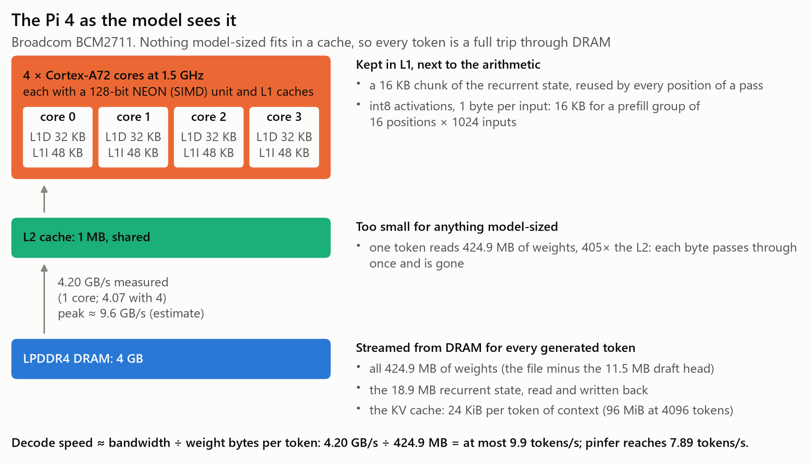
</picture>

| Part | This board (Raspberry Pi 4 Model B Rev 1.1, 4 GB) | Source |
|---|---|---|
| CPU | 4 × Cortex-A72, Armv8.0-A, 1.5 GHz | `freq_khz` `1500000` in every result file's `state_before`; [A72 TRM] §1.3 |
| L1, per core | 32 KB data (2-way), 48 KB instructions (3-way), 64-byte lines | [A72 TRM] §1.3, §2.1; [BCM2711] |
| L2 | 1 MB, shared by the four cores (the A72 allows 512 KB to 4 MB) | [BCM2711]; [A72 TRM] §1.3 |
| DRAM | 4 GB LPDDR4; Raspberry Pi gives "LPDDR4-2400" for the BCM2711 | [BCM2711] |
| DRAM read bandwidth, measured | 4.20 / 4.08 / 4.07 GB/s with 1 / 2 / 4 threads (256 MB streaming read) | `bench/results/memband_20261021_210615.json` |
| DRAM peak, **estimate** | ≈ 9.6 GB/s = 2400 MT/s × 4 bytes, assuming the 32-bit bus of `docs/design.md`. Raspberry Pi does not publish the Pi 4's bus width, and [Wikipedia's Raspberry Pi 4 article](https://en.wikipedia.org/wiki/Raspberry_Pi_4) gives "LPDDR4 RAM running at 3.2 GHz" (12.8 GB/s on the same assumption); the figure labels the number as an estimate and no conclusion depends on it | — |
| Instruction set | `/proc/cpuinfo` features `fp asimd evtstrm crc32 cpuid`: no `asimdhp` (fp16), `asimddp` (dot product) or `i8mm`; the TRM's reset values agree (ID_AA64PFR0_EL1 = 0x2222: no half precision; ID_AA64ISAR0_EL1 = 0x10000: no dot product) | `state_before.cpu_features`; [A72 TRM] chapter 4 |

What pinfer moves per generated token (Q4K default, plain decode): all 424.9 MB of weights, which is
405× the 1 MiB L2 (tensor directory of the `.pq` file, §5); the 18.9 MB recurrent state, read and
written; and 24 KiB of fp32 KV cache per token of context (96 MiB at 4096 tokens). What stays in L1: a
16 KB chunk of the recurrent state while all positions of a pass use it (`engine/VERIFY.md` §2), and the
int8 activations, one byte per input: 16 KB for a prefill group of 16 positions on a 1024-input matrix
(`engine/bench/KERNELS.md` v13). For the 3584-input MLP down projection a group of 16 is 56 KB, more than
the 32 KB L1D, and that matrix measured faster with groups of 8 (11.0 against 11.9 ms at n = 64,
KERNELS.md v13).

<picture>
  <source media="(max-width: 600px) and (prefers-color-scheme: dark)" srcset="figures/roofline-mobile-dark.png">
  <source media="(max-width: 600px)" srcset="figures/roofline-mobile.png">
  <source media="(prefers-color-scheme: dark)" srcset="figures/roofline-dark.png">
  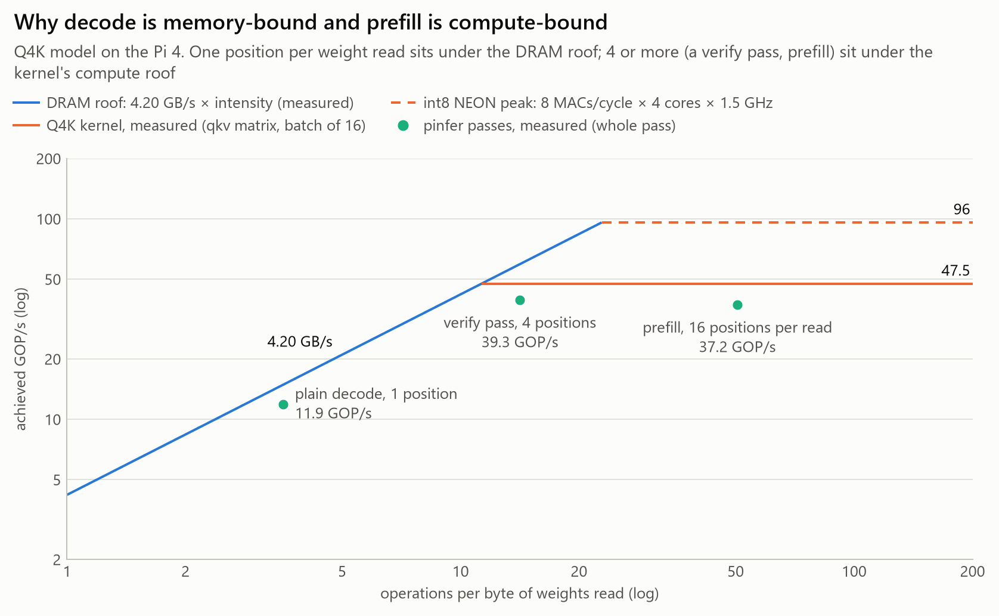
</picture>

**Roofline.** The x axis is arithmetic intensity: operations per byte of weights read from DRAM. The y
axis is achieved GOP/s. The roofs:

- **DRAM roof:** 4.20 GB/s × intensity (memband, one thread).
- **int8 instruction peak, 96 GOP/s.** The [A72 SOG] §3.14 lists `SMULL(2)` / `SMLAL(2)` at a throughput
  of one per cycle on pipeline F0 only, and `SADALP` at one per cycle on F1, so in principle the widening
  issues alongside. One `SMULL`/`SMLAL` multiplies 8 int8 pairs (8 multiply-accumulates, 16 operations):
  8 × 2 × 4 cores × 1.5 GHz = 96 GOP/s. `ubench` confirms 1.00 cycle per `SMULL`/`SMLAL` but finds that
  `SADDLP` does not overlap with them (`engine/bench/KERNELS.md` "Machine facts"), so no kernel gets there.
- **Q4K kernel, measured: 47.5 GOP/s.** `kbench`, cold weights, 4 threads, the largest layer matrix (qkv,
  6144 × 1024) at a batch of 16 in 4238.94 µs (`bench/results/kbench-v13-group_20261022_005221.json`,
  variant `v13-group16`). It is a representative value, not a maximum: the same file gives 39.4–49.6 GOP/s
  over the four layer shapes (qkv, gate, down, out) at batches of 4, 16 and 64. At 47.5 the kernel roof
  meets the DRAM roof at 11.3 operations per byte, between 3 and 4 positions per weight read; the
  instruction peak meets it at 22.8.

The points: operations = 2 × the multiply-accumulates of the weight matrices (a plain step multiplies
751,894,528 Q4K weights, 254,279,680 of them in the tied head; counted from the `.pq` directory); bytes =
the weight bytes streamed; achieved = operations ÷ the whole pass's time. Attention, the recurrence and the
other per-token work take time but are not counted, so every point sits below its roof (at 78–83% of the
roofs drawn).

| Pass | Positions per weight read | Operations | Bytes read | Ops / byte | Time | GOP/s | Source |
|---|---|---|---|---|---|---|---|
| Plain decode | 1 | 1.504 G | 424.9 MB | 3.54 | 126.7 ms (7.89 tok/s) | 11.9 | `speed-ab-merge4_20261022_103609` |
| Verify pass, k = 3 | 4 | 6.015 G | 424.9 MB | 14.2 | 152.9 ms | 39.3 | `engine/VERIFY.md` (`ver3-ab-p64_20261022_080513`) |
| Prefill, 64 tokens | 16 (4 groups; head once) | 64.20 G | 1270.6 MB | 50.5 | 1.725 s (37.1 tok/s) | 37.2 | `speed-ab-merge4_20261022_103609` |

So decode leaves three quarters of the kernel's arithmetic unused, and a verify pass over 4 positions
costs 1.20× a plain step instead of 4× (152.9 against 127.1 ms in the same `engine/VERIFY.md` run). Past
about 4 positions per read the kernel's compute roof takes over, and further positions per pass are no
longer nearly free.

<picture>
  <source media="(max-width: 600px) and (prefers-color-scheme: dark)" srcset="figures/arm_isa-mobile-dark.png">
  <source media="(max-width: 600px)" srcset="figures/arm_isa-mobile.png">
  <source media="(prefers-color-scheme: dark)" srcset="figures/arm_isa-dark.png">
  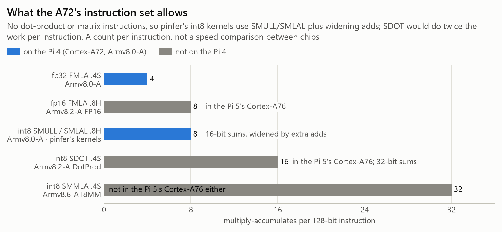
</picture>

**Instruction set.** Multiply-accumulates per 128-bit instruction, from the instruction descriptions in
the [A64 ISA]:

| Instruction | MACs | Sums in | Feature | Cortex-A72 (Pi 4) | Cortex-A76 (Pi 5) |
|---|---|---|---|---|---|
| `FMLA` .4S, fp32 | 4 | fp32 | Advanced SIMD, Armv8.0 | yes, 1 per cycle ([A72 SOG] §3.15) | yes |
| `FMLA` .8H, fp16 | 8 | fp16 | FEAT_FP16, optional from Armv8.2 ([features]) | no | yes ([A76 TRM]) |
| `SMULL` / `SMLAL(2)` .8H, int8 | 8 | int16 | Advanced SIMD, Armv8.0 | yes, 1 per cycle on F0 ([A72 SOG] §3.14) | yes |
| `SDOT` .4S, int8 | 16 (4 lanes × 4) | int32 | FEAT_DotProd, optional in Armv8.2–8.3, mandatory from 8.4 | no | yes ([A76 TRM] §A1.1) |
| `SMMLA` .4S, int8 | 32 (2×8 by 8×2) | int32 | FEAT_I8MM, optional from Armv8.2, mandatory from 8.6 | no | no (ID_AA64ISAR1_EL1 reset value 0x100001, I8MM field 0, [A76 TRM]) |

The 16-bit sums are the cost of `SMLAL`: Q4/Q4K put at most four products in a lane and widen to int32
with one `SADDLP` after the 4-row reduction, Q8 puts two and widens with `SADDLP` + `SADALP`
(`engine/src/kern_quant.c`), while `SDOT` accumulates straight into int32. The table counts work per instruction. It is not a claim about
how fast a Pi 5 runs this model, which also depends on its issue rate, clock and memory.

**Sources** (fetched 2026-10-22):

- **A72 TRM**: Arm Cortex-A72 MPCore Processor Technical Reference Manual r0p3 (100095_0003),
  <https://documentation-service.arm.com/static/60368ce38f952d2e4134dc2e>
- **A72 SOG**: Arm Cortex-A72 Software Optimization Guide (UAN 0016A),
  <https://documentation-service.arm.com/static/5ed75eeeca06a95ce53f93c7>
- **A76 TRM**: Arm Cortex-A76 Core Technical Reference Manual r4p1 (100798),
  <https://documentation-service.arm.com/static/5f562083235b3560a01e03bc>
- **A64 ISA**: Arm A-profile A64 Instruction Set Architecture (DDI 0602, 2024-12): `SDOT (vector)`,
  `SMMLA (vector)`, `SMLAL, SMLAL2 (vector)`, `FMLA (vector)`,
  <https://developer.arm.com/documentation/ddi0602/2024-12/SIMD-FP-Instructions>
- **features**: Arm, Feature names in A-profile architecture (109697): FEAT_FP16 and FEAT_I8MM under
  "The Armv8.2 architecture extension", FEAT_DotProd under "The Armv8.4 architecture extension",
  <https://developer.arm.com/documentation/109697/2026_06/Feature-descriptions>
- **BCM2711**: Raspberry Pi documentation, Processors, BCM2711 (and BCM2712 for the Pi 5's Cortex-A76),
  <https://www.raspberrypi.com/documentation/computers/processors.html>

[A72 TRM]: https://documentation-service.arm.com/static/60368ce38f952d2e4134dc2e
[A72 SOG]: https://documentation-service.arm.com/static/5ed75eeeca06a95ce53f93c7
[A76 TRM]: https://documentation-service.arm.com/static/5f562083235b3560a01e03bc
[A64 ISA]: https://developer.arm.com/documentation/ddi0602/2024-12/SIMD-FP-Instructions
[features]: https://developer.arm.com/documentation/109697/2026_06/Feature-descriptions
[BCM2711]: https://www.raspberrypi.com/documentation/computers/processors.html
