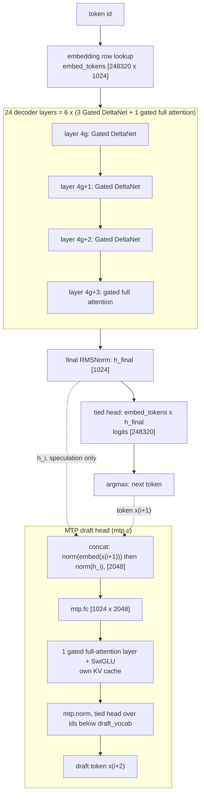
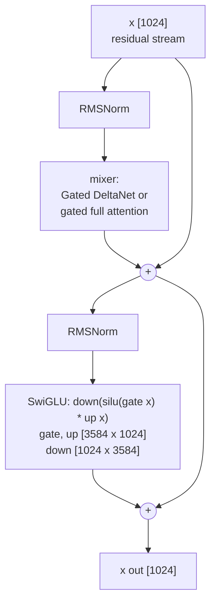
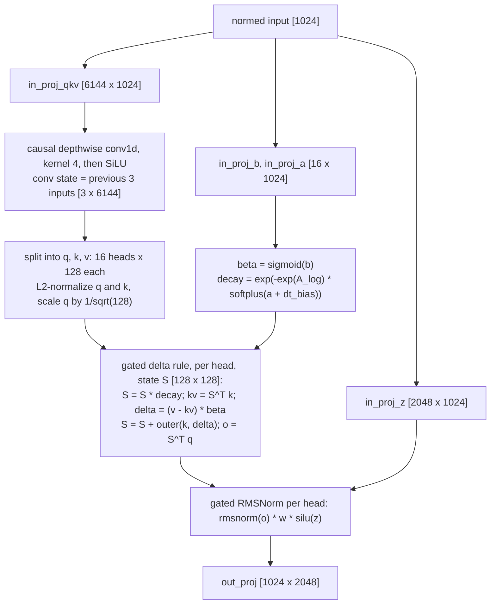
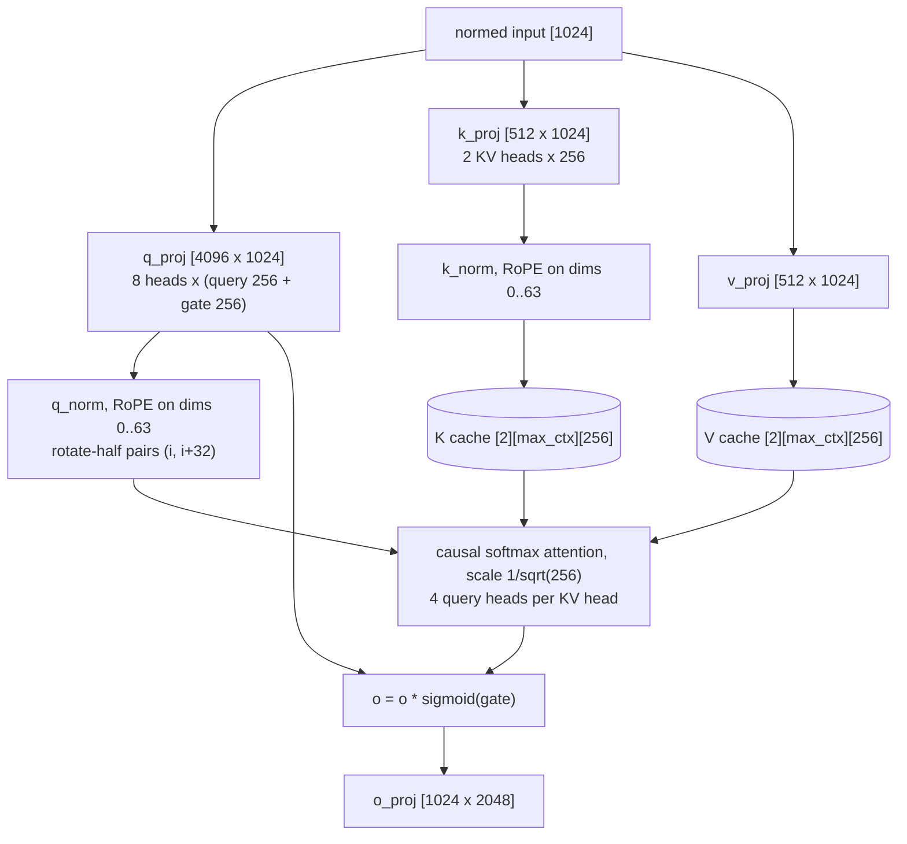
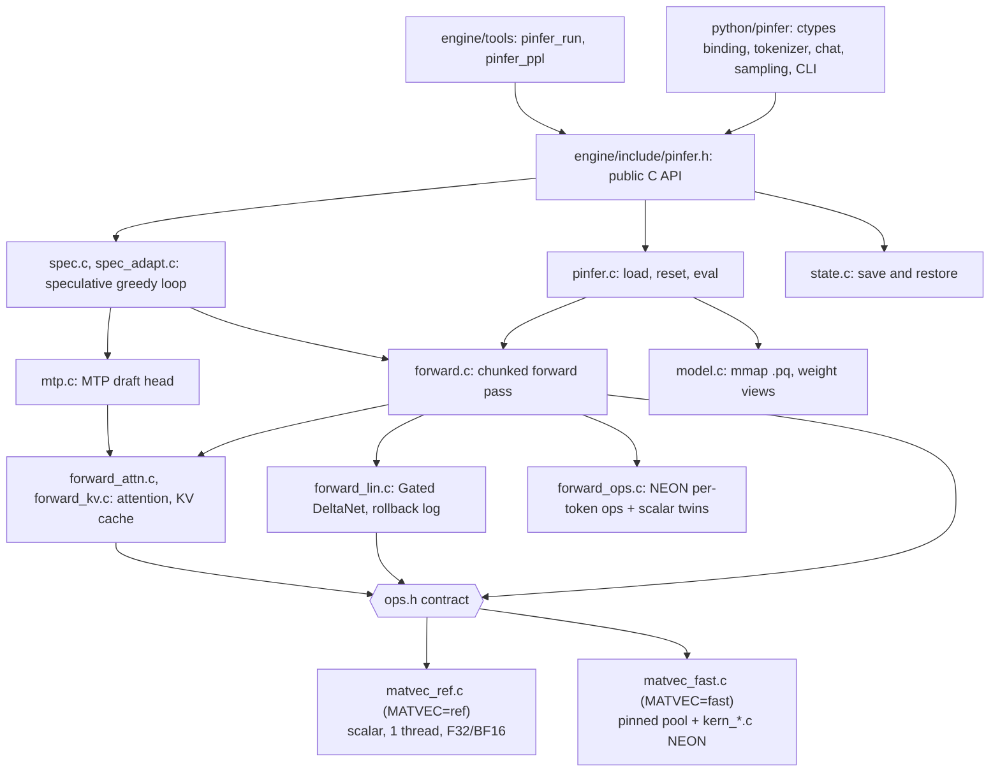
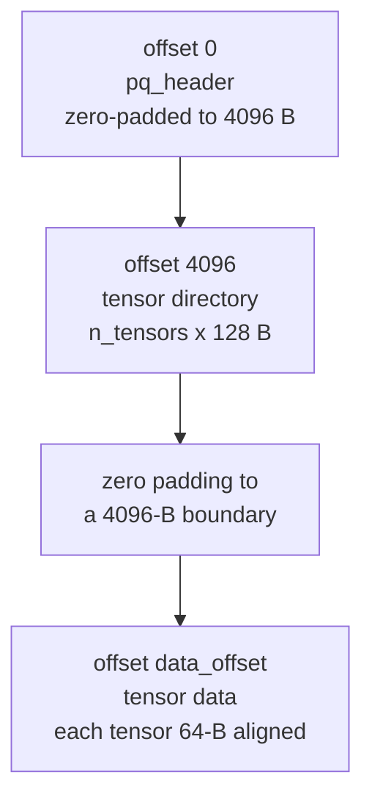
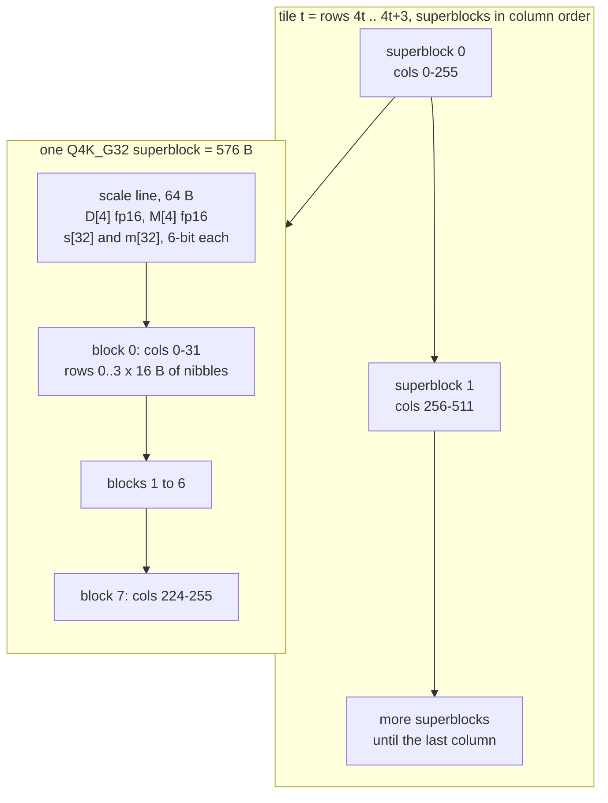
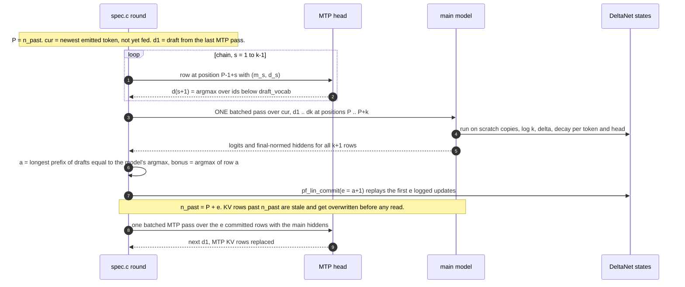

# pinfer architecture

How the engine is built: the model it runs, which file does what, the `.pq` weight format, threads and
memory, exact speculative decoding, and the bit-exactness rules that hold it together. For *why* the
design looks like this and for the headline numbers, read the [README](../README.md) first; for the exact
math of every operation, [engine/FORMAT.md](../engine/FORMAT.md). Every fact below cites its source.

1. [The model: Qwen3.5-0.8B per token](#1-the-model-qwen35-08b-per-token)
2. [Source map and the ops.h contract](#2-source-map-and-the-opsh-contract)
3. [The .pq file and the quantized tiling](#3-the-pq-file-and-the-quantized-tiling)
4. [Threading](#4-threading)
5. [Memory budget](#5-memory-budget)
6. [Exact speculative decoding](#6-exact-speculative-decoding)
7. [Bit-exactness discipline](#7-bit-exactness-discipline)
8. [Context-window work (Phase 6)](#8-context-window-work-phase-6)

## 1. The model: Qwen3.5-0.8B per token

Dimensions as stored in the `.pq` header (`engine/FORMAT.md`; read back from
`models/pq/qwen35-0.8b-q4k-headq4k.pq`):

| Item | Value |
|---|---|
| Hidden size, FFN size, vocabulary | 1024, 3584, 248,320 (embeddings tied to the output head) |
| Layers | 24: 18 Gated DeltaNet (linear attention) + 6 gated full attention at layers 3, 7, 11, 15, 19, 23 |
| Full attention | 8 query heads, 2 KV heads (GQA 4:1), head dim 256, RoPE on the first 64 dims, θ = 1e7 |
| Linear attention | 16 heads × 128 for q, k and v; causal conv kernel 4; state 128 × 128 per head |
| Other | RMSNorm eps 1e-6, EOS id 248044, plus a one-layer MTP head (`mtp.*`) |

Every decoder layer is pre-norm with two residual adds (`engine/src/forward.c` `forward_chunk`).
Norm weights are stored as the effective multiplier `1 + w` (Qwen3.5 zero-centred RMSNorm), except the
gated norm inside Gated DeltaNet, which uses `w` as is (`engine/FORMAT.md`).

The two mixers (`engine/src/forward_lin.c`, `engine/src/forward_attn.c`; math in `engine/FORMAT.md`):

**Prefill and decode use the same code.** `pf_forward_h` cuts the input into chunks of up to
`PF_MAX_BATCH = 64` tokens. Every weight matrix is applied to the whole chunk with one `pf_matmul`,
while the sequential parts (conv state, recurrence, KV-cache attention) walk the chunk's tokens in
order (`engine/src/forward.c`, `forward.h`). Only rows whose logits are needed pay for the 248,320-row
head. Decode is the same pass with n = 1.

**MTP head.** Row i takes the main model's hidden state *after* the final norm and the token x(i+1),
and drafts x(i+2); a chained step feeds the head its own output instead of h_i. The semantics come from
vLLM and llama.cpp and were validated against a PyTorch reference: 87.3% first-draft acceptance, and
both deliberate miswirings collapse it (`engine/SPEC.md` §1, §3.1).

## 2. Source map and the ops.h contract

| File | Role |
|---|---|
| `engine/include/pinfer.h` | Public API: token ids in, logits or generated ids out; error codes; `pinfer_spec_params`; state save/load |
| `engine/src/pinfer.c` | `pinfer_load` (allocates all state), `pinfer_reset`, `pinfer_eval`, `pinfer_argmax` |
| `engine/src/model.c`, `model.h` | `mmap` the `.pq` file, strict validation, per-layer weight views; opt-in `PINFER_HUGEPAGES` copy |
| `engine/src/pq_format.h`, `pq_quant.h` | On-disk header and directory structs; quantized dtype ids and superblock sizes |
| `engine/src/forward.c`, `forward.h` | Chunked forward pass (`pf_forward`, `pf_forward_h`), MLP, norms, RoPE tables; the `pinfer_ctx` struct |
| `engine/src/forward_lin.c` | Gated DeltaNet mixer; rollback log (`pf_lin_log_alloc`, `pf_lin_commit`) |
| `engine/src/forward_attn.c`, `forward_kv.c` | Gated full attention in blocks of 8 tokens; KV rows as fp32 / fp16 / int8; `pf_dot4`, `pf_attn_pv_acc` |
| `engine/src/forward_ops.c` | exp, SiLU, sigmoid, RMSNorm, L2 norm, conv, RoPE, dot, softmax, argmax: NEON bodies with bit-identical scalar mirrors |
| `engine/src/forward_stats.c`, `kern_stats.c` | Opt-in profiles: `PF_FWD_STATS=1` (per phase), `PF_KERN_STATS=1` (per matmul shape) |
| `engine/src/mtp.c`, `mtp.h` | Maps `mtp.*` tensors, owns the MTP KV cache, runs the draft head |
| `engine/src/spec.c`, `spec.h`, `spec_adapt.c` | Draft / verify / accept / commit loop; `pinfer_generate_greedy*`; adaptive-k policy |
| `engine/src/state.c` | `pinfer_state_size/save/load` |
| `engine/src/ops.h` | The only interface between model code and matrix kernels (below) |
| `engine/src/matvec_ref.c` | Scalar reference of `ops.h`: F32/BF16 only, single thread, fixed summation order |
| `engine/src/matvec_fast.c`, `kern.h` | Pinned thread pool, dispatch, per-dtype thread policy, activation quantization, prefill grouping |
| `engine/src/kern_float.c`, `kern_quant.c`, `kern_act.c` | NEON F32/BF16 kernels; Q8_G32 / Q4_G32 / Q4K_G32 kernels (`SMULL`/`SMLAL`); int8 activation quantization |
| `engine/src/kern_lin.c` | NEON Gated DeltaNet recurrence and commit replay, threaded over heads |
| `engine/tools/pinfer_run.c`, `pinfer_ppl.c` | CLI (`--bench` prints a `RESULT {json}` line); llama-perplexity-compatible perplexity |
| `engine/bench/` | `kbench` (kernels, exactness), `lbench` (recurrence), `ubench` (A72 instruction costs), `spec_exact.sh`, `core2_check.sh`, `ctx_check.sh` |
| `engine/pkg/` | Linker version script (exports `pinfer_*` only), `pinfer.pc.in`, `check_lib.sh` |
| `tools/convert.py`, `tools/quant.py` | Hugging Face safetensors → `.pq`; reference quantizers, packers, error report, kbench golden file |
| `python/pinfer/` | `_lib.py` (find and type `libpinfer.so`), `model.py`, `speculative.py`, `tokenizer.py`, `chat.py`, `sampling.py`, `streaming.py`, `cli.py`, `convert.py`, `errors.py` |
| `ref/`, `tests/` | fp32 golden-data generators (output in gitignored `ref/golden/`); host tests `test_golden.py`, `test_spec.py`, `test_state.py`; `tests/python` pytest suite |

**The ops.h contract** (`engine/src/ops.h`). The model code calls only these functions. The build picks
one implementation: `make -C engine MATVEC=ref|fast` links `matvec_ref.c`, or `matvec_fast.c` plus every
`kern_*.c` (`engine/Makefile`; the default is `ref`).

| Function | Contract |
|---|---|
| `pf_matvec(pool, W, x, y)` | `y = W x` for one vector |
| `pf_matmul(pool, W, X, Y, n)` | n vectors at once; row v of the result must equal `pf_matvec` on vector v bit for bit (§7) |
| `pf_lin_rule(pool, args)` | Gated DeltaNet recurrence of one layer over n tokens, exact per-element fp32 operations, no FMA; with `log != NULL` it leaves the state untouched and writes `k, delta, decay` per (token, head) |
| `pf_lin_apply(pool, S, log, keep, ...)` | Commit replay of the first `keep` logged updates |
| `pf_pool_run(pool, fn, arg, max)` | Generic parallel job; the split must not change any per-element arithmetic |
| `pf_get_row`, `pf_dtype_supported` | Embedding lookup (dequantized row); dtype support of this build |

`matvec_ref.c` supports only F32 and BF16, so a ref build loads only `bf16` `.pq` files (`model.c`
rejects other dtypes with `PINFER_E_FORMAT`). `matvec_fast.c` does not compile on x86 (aarch64 `yield`
asm, `engine/SPEC.md` §6): the fast kernels run on the Pi or under `qemu-aarch64`. The x86-64 wheel
therefore carries the ref kernels (`docs/library.md`).

## 3. The .pq file and the quantized tiling

One file per model, little-endian, written by `tools/convert.py`, mapped read-only by
`engine/src/model.c` (format v1, `engine/FORMAT.md`, structs in `engine/src/pq_format.h`).

- The Q4K default file has 335 tensors and `data_offset` 49,152: 195 quantized matrices (434.4 MB),
  140 F32 tensors (2.0 MB). The tied embedding/head is 143.0 MB of it, the MTP head 11.5 MB (read back
  from the file's directory).
- Directory entry: `name[80]`, `dtype`, `ndim`, `shape[4]`, `offset`, `nbytes`, 8 reserved bytes.
  Matrices are row-major with `shape[0]` = output rows, so `y = W x` reads rows contiguously.
- `model.c` checks magic, version, architecture, every dimension, bounds and 64-byte alignment of every
  tensor, so a truncated copy fails at load with `PINFER_E_FORMAT`.
- Names drop the HF prefix `model.language_model.`; vision tensors are not stored; `mtp.*` keeps its name.

**Quantized tiling** (`engine/FORMAT.md` "Quantized dtypes", `engine/src/pq_quant.h`). Rows are taken
4 at a time (a tile); each tile is a run of 256-column superblocks; a superblock is one 64-byte scale
line followed by the codes of eight 32-column blocks, block after block, row 0..3 inside a block. The
superblock size is a multiple of 64, so each scale line starts a cache line and each thread streams one
contiguous byte range (requires `rows % 4 == 0`, `cols % 256 == 0`, true for every Qwen3.5 matrix).

| id | dtype | bits/weight | superblock | scale line | weight value |
|---|---|---|---|---|---|
| 0 / 1 | F32 / BF16 | 32 / 16 | (row-major, not tiled) | — | as stored |
| 2 | Q8_G32 | 8.5 | 1088 B | fp16 `d` per 32 columns and row | `d · q`, q ∈ [−127, 127] |
| 3 | Q4_G32 | 4.5 | 576 B | fp16 `d` per 32 columns and row | `d · (u − 8)`, u ∈ [0, 15] |
| 4 | Q4K_G32 | 4.5 | 576 B | per row: fp16 `D`, `M`; per 32 columns: 6-bit `s`, `m` | `D·s·u − M·m` (k-quant style, asymmetric) |

At run time the kernels quantize activations to int8 per 32 columns (scale = absmax/127) and multiply
with `SMULL`/`SMLAL` into int16 lanes, reduce the 4 rows of a tile into one int32x4 (lane = row), and
convert once per block (`engine/src/kern_quant.c`, `kern_act.c`). Why int8: the A72 retires 8 int8 MACs
per cycle with `SMULL`/`SMLAL` but 4 fp32 MACs with `FMLA` (`engine/bench/KERNELS.md`, ubench table).

## 4. Threading

| Aspect | Behaviour | Source |
|---|---|---|
| Pool | `n_threads` threads (default 4): workers 1..n−1 are pinned to CPUs 1..n−1; the calling thread does worker 0's share, and the thread that creates the pool (the one calling `pinfer_load`) is pinned to CPU 0 | `matvec_fast.c` `pf_pool_create` |
| Dispatch | Publish the job, bump a generation counter (the futex word), wake sleepers, run worker 0's share on the caller, spin until all are done | `dispatch()` |
| Idle workers | Spin up to 50 ms (`SPIN_SEC`), then sleep on the futex: a decode step issues ~150 matmuls back to back | `worker_main()` |
| Dispatch cost | Empty job: 11 / 238 / 369 / 478 ns for 1 / 2 / 3 / 4 threads | `engine/bench/KERNELS.md` v9 |
| Matmul split | One contiguous slab of 4-row tiles per thread: one sequential DRAM stream each | `run_job()` |
| Threads per matmul | n = 1: at most F32 2, BF16 2, Q8 1, Q4 3, Q4K 3; batched calls use all threads; at least 32 KB of weights per thread | `threads_for()`, KERNELS.md v9-auto / v10 |
| Prefill batches | n > 16 runs in groups of 16 vectors; each group re-streams the weights so its int8 activations stay in L1 (−9% on the big prefill matmuls) | `pf_matmul`, KERNELS.md v13 |
| Other parallel work | `pf_pool_run`: attention (KV group × row half, then KV group × head half), conv channel ranges in multiples of 128, gated-norm heads, MLP activation slices; recurrence over the 16 heads | `forward_*.c`, `kern_lin.c`, `engine/CORE.md` round 2 |
| Ref build | Stub pool: everything runs on the calling thread | `matvec_ref.c` |

The per-dtype caps follow from the memory wall: one core already streams Q8 at 4.23–4.33 GB/s (the
DRAM limit) and extra streams cost 3–10%, while Q4/Q4K decoding needs about 40–47 cycles per 64 bytes on
one core and reaches the wall only with 2–3 threads; a cap of 3 measured 3–7% faster than 4
(`engine/bench/KERNELS.md` "Best kernel per dtype", v9-auto / v10). Isolating cores 1–3 with a custom
kernel changed decode by less than 1% (`os/kernel/KERNEL.md`, `notes.md`).

## 5. Memory budget

Q4K default model, fp32 KV cache. Sizes follow from the allocation code; measured RSS is from
`bench/results/pinfer-final2-q4k_20261022_023950.json` and `engine/CONTEXT.md` §3.

| Item | Size | When allocated | Source |
|---|---|---|---|
| Weights | 436.5 MB file, `mmap(PROT_READ, MAP_PRIVATE)`, no copy; shared through the page cache. A plain decode step streams 424.9 MB of it: everything except the 11.5 MB MTP head | `pinfer_load` | `model.c`, `.pq` directory |
| Recurrent state | 18 layers × 16 heads × 128 × 128 × 4 B = 18.9 MB | `pinfer_load` (zeroed) | `pinfer.c` |
| Conv state | 18 × 3 × 6144 × 4 B = 1.3 MB | `pinfer_load` | `pinfer.c` |
| KV cache, main | 6 layers × (K + V) × 2 heads × 256 × 4 B = 24 KiB per token; 96 MiB at `max_ctx` 4096 | `pinfer_load`, `calloc` for the full `max_ctx`; measured RSS grows only with the context actually used (last row) | `pinfer.c`, `forward_kv.c` |
| KV cache, MTP | 4 KiB per token (16 MiB at 4096) | first speculative call | `mtp.c` |
| Scratch | 64-row activation buffers, ~4 MB; attention scores 8 tokens × 8 heads × `max_ctx` floats (1 MiB at 4096) | `pinfer_load` | `pinfer.c`, `forward.h` |
| Speculation | verify logits (k+1) × 248,320 floats (~4 MB at k = 3); rollback log (k+1) × (6144 + 16 × 257) floats per linear layer (~3 MB over 18 layers at k = 3) | first speculative call | `spec.c`, `forward_lin.c` |
| Measured peak RSS | 433.0 MB plain, 451.7 MB speculative k = 3 (64-token prompt); 528 / 562 MB at a 4096-token prompt | | result files above |

`PINFER_HUGEPAGES=1` copies the weights into an anonymous THP mapping, which doubles their footprint
(peak RSS 833–837 MB in `bench/results/pinfer-k3b-thp-q4k_20261022_013420.json`) and did not speed
anything up (`notes.md` "Custom kernel").

## 6. Exact speculative decoding

The Pi is bandwidth-bound, so checking several positions in one pass over the weights costs little
more than one: a verify pass of 4 positions takes 162 ms against 127 ms for a plain step
(`pinfer-final2-q4k_20261022_023950.json`). One round (`engine/src/spec.h`, `spec.c`):

**Why the output equals plain greedy decoding.**
1. Every emitted token is the main model's argmax at its position. A draft only decides how many
   positions one pass can confirm.
2. Row j of the verify pass sees the committed history plus `cur, d1..dj`. While drafts are accepted they
   equal the model's own greedy tokens, so the row's input is exactly what plain decoding would feed.
3. The batched pass computes every row bit-identically to a single-token step (§7), so the logits, and
   therefore the argmax, are the same as in plain decoding, near-ties included.
4. Rejected work leaves no trace. KV rows past `n_past` are rewritten before any query can read them,
   because `pf_full_attn` stores a chunk's K/V before attending and attention is causal. The 18
   recurrent states are never written during verification; `pf_lin_commit` replays only the accepted
   rank-1 updates (`S = S·decay; S = S + k_i·delta_j`) with the same fp32 operations, so the state is
   bit-identical to having run only those tokens. The conv state becomes the last 3 rows of
   (old state, accepted raw inputs) (`engine/src/forward_lin.c`, `engine/SPEC.md` §2).

Rollback by replay needs no snapshot and no second copy of the 19 MB state: the verify pass works on a
scratch copy of one layer's state at a time (1 MB in `kern_lin.c`, one 64 KB head in `matvec_ref.c`), and
the commit reads and writes the state once (`engine/SPEC.md` §2). Measured per round at k = 3: the logged
recurrence including its copies 22.8 ms (`engine/CORE.md` final profile), the commit 13.8 ms
(`pinfer-final2-q4k_20261022_023950.json`).

**Draft vocabulary.** The tied head is 93% of a bf16 MTP step's bytes, so drafts take the argmax over
token ids below `draft_vocab` only (default 32,768; `pinfer_default_spec_params` = k 2, draft_vocab
32768). Verification always uses the full head, so this changes acceptance, never output
(`engine/SPEC.md` §2, §3.4). Measured costs per round at k = 3 on the Q4K model: MTP 25.2 ms, verify
162.1 ms, commit 13.8 ms, 3.32 tokens per pass, 16.49 tok/s against 7.88 plain
(`pinfer-final2-q4k_20261022_023950.json`).

## 7. Bit-exactness discipline

"Bit-exact" here means that the engine's own paths agree with each other to the last bit: batched and
single-token, NEON and scalar, 1 and 4 threads. Agreement with the fp32 transformers reference is a
separate, looser check (worst per-layer relative error ≤ 3.2e-6, `engine/CORE.md` round 1).

| Invariant | How the code keeps it | Checked by |
|---|---|---|
| Row v of `pf_matmul(n)` equals `pf_matvec` on vector v, every dtype, shape, thread count, n | Same instruction sequence per vector for every batch width; Q4/Q4K fold the offset term into the accumulator after each block for every nv | `kbench` `exact` field (memcmp): 588/588 in `bench/results/kbench-v11-exact_20261022_004156.json` |
| NEON per-token ops equal their scalar twins, independent of rows per call | 4 or 16 interleaved partial sums combined as (s0+s1)+(s2+s3); no fused multiply-add (`-std=c11 -ffp-contract=off` in `engine/Makefile`) | `engine/bench/core2_check.sh`: md5 of hidden states and logits for `-b 64`, `-b 1` and the `-DPF_NO_NEON` build |
| Results independent of thread count | Threads split only independent rows, heads, channel ranges or KV groups, never a reduction, so each output element is computed by one thread | By construction (`engine/CORE.md` "Rules kept throughout"); no separate cross-thread test |
| Recurrence kernel equals the scalar code; replay equals a direct run | Same per-element operations and order; the chunk-major state layout is private to `pf_lin_*` | `engine/bench/lbench.c` (n = 1, 4, 64; logged; replay) |
| Block attention equals the one-head-at-a-time loop | `pf_dot4` keeps `pf_dot`'s lane order; `pf_attn_pv_acc` keeps the row order | `engine/bench/ctx_check.sh`: 5/5 identical (`bench/results/ctx-check_20261022_025513.json`) |
| Speculative output equals plain greedy | All of the above plus the exact rollback (§6) | `engine/bench/spec_exact.sh` on the Pi (20/20 configurations); `tests/test_spec.py` on the host |

**Why it exists: the near-tie divergence (journal 2026-10-22, 00:30–00:36).** A chat demo gave different
text with and without `--speculative` on the `mix-headq4k` model. In C, `pinfer_run_fast --spec 0` and
`--spec 2` diverged at generated token 18 on the `chat27` prompt; `q4k-headq4k` and `prompt64` were
identical. The speculation logic was exact (scalar kernels passed); the NEON kernels were not. The
single-vector Q4/Q4K pass kept the offset term `o·sum(x)` in a separate register and subtracted it at the
end, while the batched passes folded it into the accumulator after each block: two rounding sequences,
so verify logits differed from decode logits in the last bits and a near-tie argmax flipped
(`engine/bench/KERNELS.md` v11). The fix uses the fold-in form for every batch width (no speed cost) and
added the memcmp check to kbench. On the Pi, `spec-exact-old_20261022_004457.json` shows 16/20 matches
(all four misses are mix-headq4k / chat27, k ≥ 1); `spec-exact-lin_20261022_004711.json` and every later
run show 20/20.

The rule that follows (`engine/CORE.md` "Rules kept throughout"): anything on by default must keep these
invariants; anything that changes outputs is opt-in. Examples of opt-ins: `kv_dtype` fp16 / int8
(`engine/include/pinfer.h`); a k-quant style integer path was not built because it would change the
activation numerics the perplexity was measured with (KERNELS.md v12).

## 8. Context-window work (Phase 6)

Owner notebook: `engine/CONTEXT.md`; numbers: `docs/RESULTS.md` §6.

- **Attention path** (`forward_attn.c`, `forward_kv.c`): blocks of up to 8 tokens per pass over the
  cache; each K row is read once and dotted with the 4 query heads of its KV group. KV traffic per
  decode step drops from 8 passes to one per group; bit-identical to the old loop. Decode at 4096 tokens
  is 81% of decode at 64 with the fp32 cache, 84% with fp16 (`engine/CONTEXT.md` §2–3).
- **KV storage** `pinfer_params.kv_dtype`: fp32 (default, exact), fp16, int8 with one fp32 scale per row;
  opt-in because they round the cache.
- **State save/restore** (`state.c`): a blob of header + conv and recurrent states (20.2 MB) + K/V rows +
  MTP rows; continuing from a restored state is bit-identical (`tests/test_state.py`).
- **Adaptive speculation** (`spec_adapt.c`, `pinfer_spec_params.adaptive`): picks k per round from
  measured costs and first-draft acceptance, down to plain steps; output never depends on it.
- **Not done:** bounded-context mode (attention sinks + sliding window), design only (§7 of the notebook).
