# Results

Every measurement behind the [README](../README.md) figures, with its result file. A file name such as
`pinfer-final2-q4k_20261022_023950` means `bench/results/pinfer-final2-q4k_20261022_023950.json`. How
these files are produced and read: [REPRODUCE.md](REPRODUCE.md). Running scoreboard: `notes.md`.

**Conditions, unless a table says otherwise.** Raspberry Pi 4 Model B Rev 1.1 (4 GB, Cortex-A72 at
1.5 GHz), governor `ondemand`, stock kernel `6.18.50+rpt-rpi-v8`, 4 KB pages. 4 threads. Prompt
`bench/common/prompt64.ids` (64 tokens of *A Tale of Two Cities*), 64 generated tokens, greedy. Decode tok/s
counts generated tokens 2..64, because token 1 comes from the prefill logits; prefill tok/s = 64 / prompt
time (`engine/tools/pinfer_run.c`). "Speculative" = exact MTP self-speculation with draft vocabulary
32,768. Every quoted run has `valid=true`: exit code 0 and throttle flags `0x0` (`harness/pi.py`).

Contents: [scoreboard](#1-scoreboard) · [formats](#2-pinfer-by-weight-format) ·
[speculation](#3-speculative-decoding) · [prefill](#4-prefill) · [perplexity](#5-perplexity) ·
[context length](#6-context-length) · [time per step](#7-where-the-time-goes) ·
[kernels](#8-kernels-and-memory-bandwidth) · [quantization error](#9-quantization-error) ·
[OS experiment](#10-os-experiment) · [baselines per thread](#11-standard-runtimes-per-thread-count) ·
[correctness](#12-correctness-record) · [figures](#13-figures)

## 1. Scoreboard

<picture>
  <source media="(max-width: 600px) and (prefers-color-scheme: dark)" srcset="figures/decode_speed-mobile-dark.png">
  <source media="(max-width: 600px)" srcset="figures/decode_speed-mobile.png">
  <source media="(prefers-color-scheme: dark)" srcset="figures/decode_speed-dark.png">
  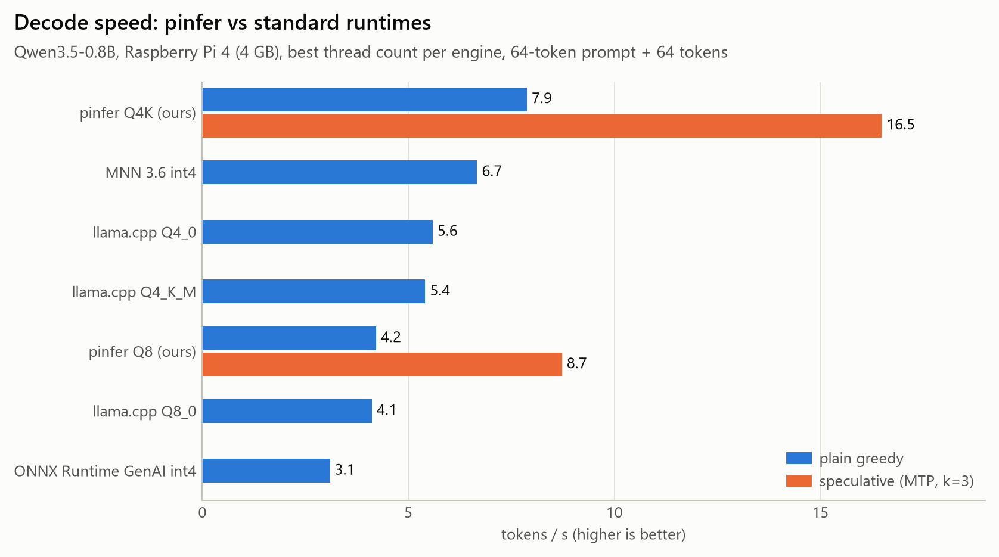
</picture>

| Engine | Format | File size | Decode, plain | Decode, speculative | Prefill | PPL (8×512) | Result files |
|---|---|---|---|---|---|---|---|
| **pinfer** | Q4K_G32, Q4K head | 437 MB | **7.88** | **16.49** (k=3) | **37.4** | 18.50 | `pinfer-final2-q4k_20261022_023950`, `pinfer-ppl-c8-final2-q4k_20261022_024414` |
| MNN 3.6.1 | int4 HQQ, block 64 | ~450 MB | 6.67 (2 threads) | — | 30.9 | — | `mnn-qwen35-0.8b-int4_20261021_221038` |
| llama.cpp v0.7.0 | Q4_0 | 513 MB | 5.59 | — | 15.7 | 21.25 | `llamacpp-qwen35-0.8b-Q4_0_20261021_213343` |
| llama.cpp v0.7.0 | Q4_K_M | 542 MB | 5.41 | — | 14.8 | 18.59 | `llamacpp-qwen35-0.8b-Q4_K_M_20261021_213929` |
| llama.cpp v0.7.0 | Q8_0 | 834 MB | 4.12 (2 threads) | — | 17.1 | 17.97 | `llamacpp-qwen35-0.8b-Q8_0_20261021_214506` |
| ONNX Runtime GenAI 0.18 | int4 RTN, block 32 | — | 3.10 | — | 9.9 | — | `ort-qwen35-0.8b-int4-acc4_20261021_222410` |
| LiteRT-LM 0.15–0.18.1 | int8 | 965 MB | does not run: prebuilt binaries need ARMv8.2 (aes, dotprod, fp16, lse) | | | | `bench/BASELINES.md` |
| PyTorch 2.14.1 + transformers | fp32 | 3 GB | not timed: 4.8 GB peak RSS on the PC, more than the Pi's ~3.5 GB free | | | | `bench/BASELINES.md` |

- llama.cpp numbers are `llama-bench` pp64 / tg64 with random tokens; the other engines use the shared
  64-token prompt (`bench/BASELINES.md` "Protocol"). llama.cpp perplexities are from the PC on the same
  8 chunks (`bench/quality/llamacpp_pc_c8.txt`); pinfer's are from the Pi (§5).
- MNN's best decode is at 2 threads (6.31 at 4), its best prefill at 4; llama.cpp Q8_0 decodes fastest at 2.

<picture>
  <source media="(max-width: 600px) and (prefers-color-scheme: dark)" srcset="figures/speed_vs_quality-mobile-dark.png">
  <source media="(max-width: 600px)" srcset="figures/speed_vs_quality-mobile.png">
  <source media="(prefers-color-scheme: dark)" srcset="figures/speed_vs_quality-dark.png">
  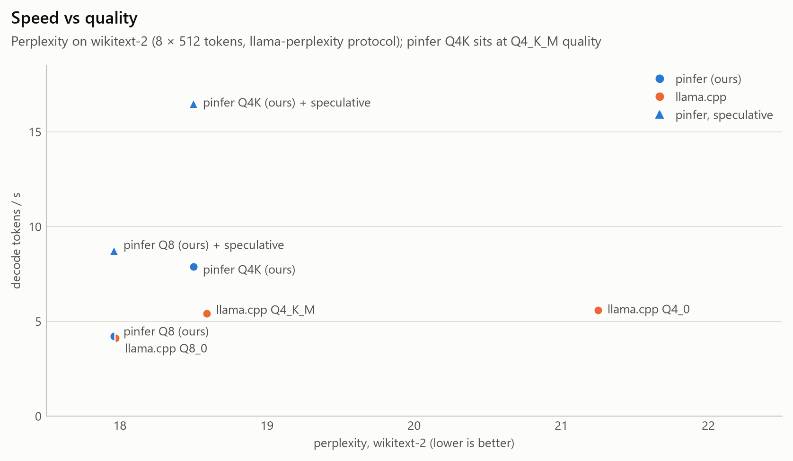
</picture>

## 2. pinfer by weight format

| `.pq` file (`models/pq/qwen35-0.8b-…`) | Layers / head | Size | Plain | Speculative (best) | Prefill | PPL | Speed file |
|---|---|---|---|---|---|---|---|
| `q4k-headq4k` (default) | Q4K / Q4K | 436.5 MB | **7.88** | **16.49** (k=3) | **37.4** | 18.50 | `pinfer-final2-q4k_20261022_023950` |
| `q4-headq4` | Q4 / Q4 | 436.5 MB | 6.88 | 12.56 (k=3) | 21.3 | 21.61 | `pinfer-fast-q4-headq4_20261021_235002` |
| `q4-headq4k` | Q4 / Q4K | 436.5 MB | 6.82 | 10.64 (k=3) | 20.8 | 21.58 | `pinfer-fast-q4-headq4k_20261022_002551` |
| `mix-headq4k` | Q4K + `v_proj`, `mtp.fc` in Q8 / Q4K | 439.4 MB | 6.88 | 10.98 (k=3) | 16.3 | 18.50 | `pinfer-fast-mix-headq4k_20261021_234923` |
| `mix-headq8` | as above / Q8 | 566.5 MB | 5.72 | 9.77 (k=3) | 13.7 | 18.29 | `pinfer-fast-mix-headq8_20261021_235049` |
| `q8-headq8` | Q8 / Q8 | 822.7 MB | 4.22 | 8.73 (k=4, draft vocab 16,384) | 12.2 | 17.96 | `pinfer-fast-q8-headq8_20261021_235144` |
| `bf16` | BF16 / BF16 | 1546.7 MB | 2.27 | 4.13 (k=2) | 11.0 | — | `pinfer-spec-fast-k0_20261021_231307`, `pinfer-spec-fast2-dickens64-k2-v32768_20261021_234027` |

Perplexity files: `pinfer-ppl-c8-{final2-q4k_20261022_024414, q4-headq4_20261022_000200,
q4-headq4k_20261022_002530, mix-headq4k_20261021_235706, mix-headq8_20261022_000705,
q8-headq8_20261022_001231}`.

**Read the rows below the first as one batch.** Only the default file was re-measured with the final
engine. The other rows come from the first NEON kernels (2026-10-21 23:49 to 2026-10-22 00:25), when the
same Q4K file gave 6.83 plain / 11.57 speculative / 19.3 prefill
(`pinfer-fast-q4k-headq4k_20261022_001957`). Those runs had no warm-up, and the plain run comes first in
each loop; the Q8 file shows 12.2 prefill in its plain run but 19.4–19.8 in the speculative runs of the
same loop. That pattern is consistent with the cold-page-cache effect that later led to the `--bench`
warm-up (`notes.md` "Custom kernel", `engine/CORE.md`), so treat the older prefill numbers as lower
bounds. Verdicts from this table (`notes.md`): symmetric Q4 *layers* lose the quality (21.58 even with a
Q4K head); Q8 overrides for sensitive tensors buy nothing (18.50 vs 18.48); a Q8 head lowers perplexity
by 0.2 and costs 11% of the speculative speed.

## 3. Speculative decoding

<picture>
  <source media="(max-width: 600px) and (prefers-color-scheme: dark)" srcset="figures/speculative_k-mobile-dark.png">
  <source media="(max-width: 600px)" srcset="figures/speculative_k-mobile.png">
  <source media="(prefers-color-scheme: dark)" srcset="figures/speculative_k-dark.png">
  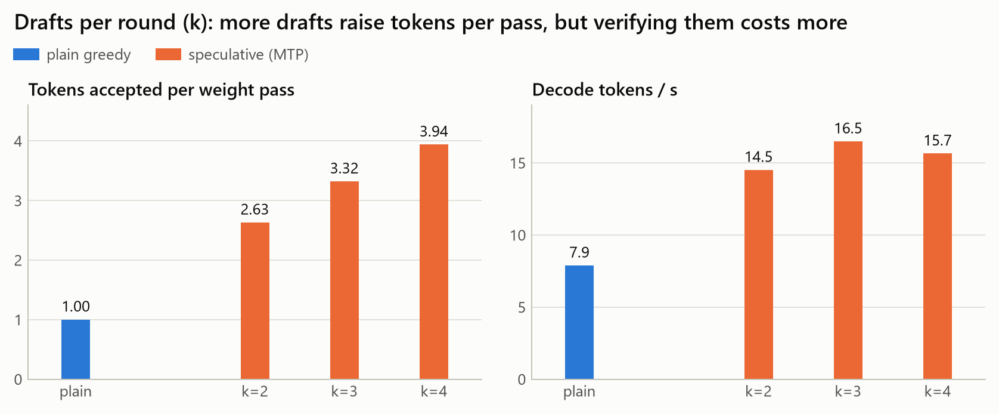
</picture>

**Per k, default model, final engine** (`pinfer-final2-q4k_20261022_023950`; plain step = 1000 / 7.876 =
127.0 ms):

| k | tok/s | vs plain | Tokens per pass | Accept rate | MTP ms / pass | Verify ms / pass | Verify / plain step | Commit ms / pass |
|---|---|---|---|---|---|---|---|---|
| 0 | 7.88 | 1.00× | 1 | — | — | — | — | — |
| 2 | 14.51 | 1.84× | 2.63 | 0.81 | 16.8 | 150.8 | 1.19 | 13.3 |
| 3 | **16.49** | **2.09×** | 3.32 | 0.77 | 25.2 | 162.1 | 1.28 | 13.8 |
| 4 | 15.65 | 1.99× | 3.94 | 0.76 | 32.9 | 204.5 | 1.61 | 14.3 |

The verify / plain-step ratio at k=3 fell from 1.65 (`pinfer-kstats-q4k-spec3_20261022_003024`) to 1.48
(bit-exact kernels + NEON recurrence) to 1.24–1.28 (vectorized per-token ops) (`engine/bench/KERNELS.md`
Part 2, `engine/CORE.md`).

<picture>
  <source media="(max-width: 600px) and (prefers-color-scheme: dark)" srcset="figures/mtp_acceptance-mobile-dark.png">
  <source media="(max-width: 600px)" srcset="figures/mtp_acceptance-mobile.png">
  <source media="(prefers-color-scheme: dark)" srcset="figures/mtp_acceptance-dark.png">
  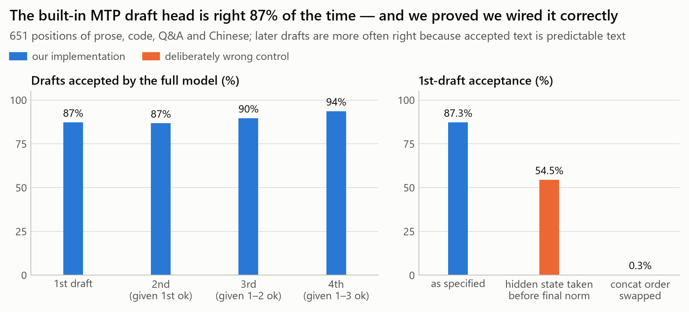
</picture>

**MTP acceptance, PyTorch reference** (fp32, 7 varied prompts, 96 tokens each, 651 scored positions;
`engine/SPEC.md` §3.1, `logs/spec/mtp_reference_20261021_215644.log`):

| Variant | P(d1 ok) | P(d2 ok \| d1) | P(d3 ok \| d1,d2) | P(d4 ok \| d1..d3) |
|---|---|---|---|---|
| As specified, full vocabulary | 0.873 | 0.868 | 0.897 | 0.937 |
| Draft vocabulary 131,072 | identical | | | |
| Draft vocabulary 65,536 | 0.810 | 0.865 | 0.899 | 0.920 |
| Draft vocabulary 32,768 | 0.763 | 0.815 | 0.835 | 0.837 |
| Control: hidden state taken before the final norm | 0.545 | 0.369 | 0.374 | 0.388 |
| Control: concatenation order swapped | 0.003 | 0 | 0 | 0 |

**Tokens per verification pass in the engine** (host, 7 varied prompts, 64 tokens; `engine/SPEC.md` §3.4,
`logs/spec/accept_sweep_20261021_222813.log`, `…_224314.log`). Per-position rates overstate this, because
every round starts right after a rejection.

| k \ draft vocab | full | 131,072 | 65,536 | 32,768 | 16,384 |
|---|---|---|---|---|---|
| 1 | 1.793 | 1.793 | 1.736 | 1.670 | |
| 2 | 2.423 | 2.423 | 2.216 | 2.120 | |
| 3 | 2.864 | 2.864 | 2.534 | 2.371 | |
| 4 | 3.219 | 3.219 | 2.827 | 2.625 | 2.564 |

**History on the bf16 model** (`engine/SPEC.md` §4; same prompt, 64 tokens):

| Kernels | Plain | Best speculative | Gain | Files |
|---|---|---|---|---|
| Scalar ref, 1 thread | 1.546 | 1.151 (k=1) | 0.74× (compute-bound: verify costs ≈ k+1 steps) | `pinfer-spec-ref-k{0,1}_20261021_*` |
| NEON, 4 threads, full vocab | 2.274 | 2.854 (k=1) | 1.26× | `pinfer-spec-fast-k{0,1}_20261021_*` |
| NEON, draft vocab 131,072 | | 3.497 (k=2) | 1.54× | `pinfer-spec-fast-k2-v131072_20261021_233341` |
| NEON, draft vocab 32,768 | | 3.993 (k=3) | 1.76× | `pinfer-spec-fast-k3-v32768_20261021_233457` |

Prompt dependence (bf16, NEON, k=2, draft vocab 32,768; `pinfer-spec-fast2-*_20261021_23*`): Dickens
2.308 → 4.130 (1.79×), "The French Revolution began in 1789 when" 2.326 → 3.272 (1.41×), a quicksort
docstring 2.331 → 4.503 (1.93×). Every speculative run generated exactly the plain tokens.

## 4. Prefill

<picture>
  <source media="(max-width: 600px) and (prefers-color-scheme: dark)" srcset="figures/prefill_speed-mobile-dark.png">
  <source media="(max-width: 600px)" srcset="figures/prefill_speed-mobile.png">
  <source media="(prefers-color-scheme: dark)" srcset="figures/prefill_speed-dark.png">
  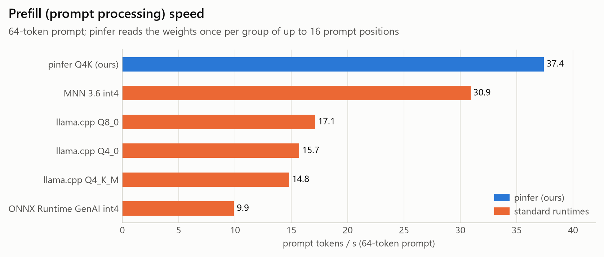
</picture>

| Engine (64-token prompt) | Prefill tok/s | Threads | File |
|---|---|---|---|
| pinfer Q4K | **37.4** | 4 | `pinfer-final2-q4k_20261022_023950` |
| MNN 3.6.1 int4 | 30.9 | 4 | `mnn-qwen35-0.8b-int4_20261021_221038` |
| llama.cpp Q8_0 / Q4_0 / Q4_K_M | 17.1 / 15.7 / 14.8 | 4 | `llamacpp-*` (pp64, random tokens) |
| ONNX Runtime GenAI int4 | 11.0 (3 threads), 9.9 (4 threads) | 3 / 4 | `ort-qwen35-0.8b-int4-acc4_20261021_222410` |

pinfer prefill went 19.3 → 26.1 (grouped batched matmuls + NEON recurrence) → 37.4 (vectorized per-token
ops), files in §7. Longer prompts: §6.

## 5. Perplexity

wikitext-2-raw-v1 test (`bench/quality/wikitext-2-raw-test.txt`, sha256 `bbf94c53…`), llama-perplexity
protocol: 512-token chunks, state reset per chunk, the second half of each chunk scored (255 tokens per
chunk). `±` is the standard-error estimate llama-perplexity prints; `engine/tools/pinfer_ppl.c` computes
it the same way. All variants score the same tokens.

| Model | 8 chunks (2,040 tokens) | 64 chunks (16,320 tokens), PC | Where | Evidence |
|---|---|---|---|---|
| pinfer Q8 (`q8-headq8`) | 17.96 ± 1.21 | | Pi | `pinfer-ppl-c8-q8-headq8_20261022_001231` |
| pinfer Q4K + Q8 head (`mix-headq8`) | 18.29 ± 1.24 | | Pi | `pinfer-ppl-c8-mix-headq8_20261022_000705` |
| pinfer Q4K (default), first NEON kernels and `af06041` | 18.48 ± 1.25 | | Pi | `pinfer-ppl-c8-q4k-headq4k_20261022_001936`, `pinfer-ppl-c8-final-q4k_20261022_011638` |
| pinfer Q4K (default), vectorized engine | 18.50 ± 1.25 | | Pi | `pinfer-ppl-c8-final2-q4k_20261022_024414` |
| pinfer Q4K mix (`mix-headq4k`) | 18.50 ± 1.25 | | Pi | `pinfer-ppl-c8-mix-headq4k_20261021_235706` |
| pinfer Q4 layers + Q4K head | 21.58 ± 1.50 | | Pi | `pinfer-ppl-c8-q4-headq4k_20261022_002530` |
| pinfer Q4 (`q4-headq4`) | 21.61 ± 1.51 | | Pi | `pinfer-ppl-c8-q4-headq4_20261022_000200` |
| llama.cpp bf16 | 17.93 ± 1.21 | 17.94 ± 0.43 | PC x86 | `bench/quality/llamacpp_pc_c8.txt`, `bench/quality/results_pc_c64.jsonl` |
| llama.cpp Q8_0 | 17.97 ± 1.21 | 17.97 ± 0.43 | PC x86 | same |
| llama.cpp Q4_K_M | 18.59 ± 1.26 | 18.64 ± 0.44 | PC x86 | same |
| llama.cpp Q4_0 | 21.25 ± 1.47 | 22.05 ± 0.54 | PC x86 | same |

- The 0.02 change of the default model between the two engine versions comes from the NEON `exp`
  (within 1 ulp of libm, `engine/CORE.md`); both values are quoted in the docs (18.48 in
  `docs/library.md`, 18.50 in the README).
- Tool check: `pinfer_ppl` and `llama-perplexity` on the same 2 chunks gave 15.1743 and 15.1695
  (`docs/journal/2026-10-21.md`, 23:38).
- Why 8 chunks: `bench/BASELINES.md` estimates ~35 minutes for a 64-chunk `llama-perplexity` run on the
  Pi, over the 20-minute lock cap; an 8-chunk `pinfer_ppl` run takes 3–5 minutes (`seconds` field of the
  files above). On the PC, 8 and 64 chunks rank the llama.cpp formats in the same order (`notes.md`).

## 6. Context length

Q4K default, 4 threads, 32 generated tokens. Prompts `bench/common/ctx{64,512,2048,4096,8192}.ids` are the
first N tokens of `bench/quality/wikitext2-qwen35.tokens.bin`; "64 Dickens" is `prompt64`.

<picture>
  <source media="(max-width: 600px) and (prefers-color-scheme: dark)" srcset="figures/context_length-mobile-dark.png">
  <source media="(max-width: 600px)" srcset="figures/context_length-mobile.png">
  <source media="(prefers-color-scheme: dark)" srcset="figures/context_length-dark.png">
  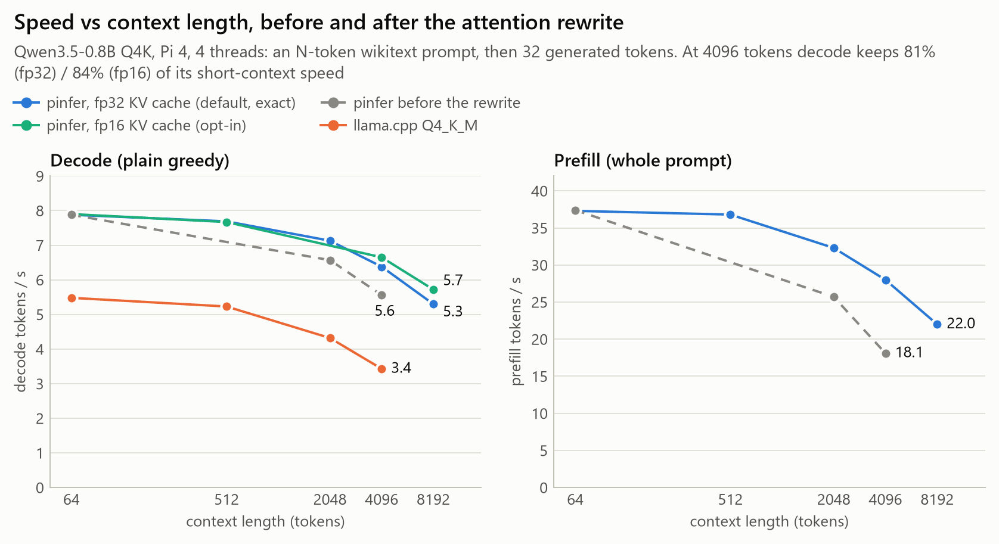
</picture>

**Before the attention rewrite** (`notes.md` "Context length"; the figure's "before" line uses only the
vectorized-binary rows: 64, 2048 from `pinfer-ctx2048-profile-q4k_20261022_024112`, 4096):

| Context | Binary | Plain | Speculative k=3 (tokens/pass) | Prefill | Peak RSS (spec run) | File |
|---|---|---|---|---|---|---|
| 512 | pre-vectorization | 6.20 | 9.04 (3.10) | 21.6 | 463 MB | `pinfer-ctx512-q4k_20261022_021315` |
| 2048 | swapped mid-run | 4.12 | 2.39 (1.63) | 11.6 | 505 MB | `pinfer-ctx2048-q4k_20261022_022009` |
| 2048 | vectorized (profiled, 16 gen) | 6.57 | – | 25.7 | 478 MB | `pinfer-ctx2048-profile-q4k_20261022_024112` |
| 4096 | vectorized | 5.56 | 5.69 (2.38) | 18.1 | 561 MB | `pinfer-ctx4096-q4k_20261022_023914` |

**After the attention rewrite** (final binary `pinfer_run_ctx7`, md5 `9d30bbda…`, merged as the shared
`pinfer_run_fast`; bit-identical output; `engine/CONTEXT.md` Summary):

| Context | Plain fp32 KV | Plain fp16 KV | Speculative k=3 fixed (tokens/pass) | Adaptive | Prefill | Peak RSS fp32 / fp16 | File(s) |
|---|---|---|---|---|---|---|---|
| 64 Dickens (64 gen) | 7.88 | 7.90 | 16.79 (3.32) | 16.42 | 37.3 | 433 / 431 MB | `pinfer-ctx7-p64_20261022_061114` |
| 512 | 7.69 | 7.67 | 15.24 (3.10) | – | 36.8 | 443 / 436 MB | `pinfer-ctx512-new-q4k_20261022_025648`, `pinfer-final-kv{0,1}-ctx512_*` |
| 2048 | 7.13 | – | 7.47 (1.82); 9.13 with 64 gen | 9.57 (64 gen) | 32.3 | 479 MB | `pinfer-ctx2048-new-q4k_20261022_030125`, `pinfer-adaptive2-ctx2048_20261022_045927` |
| 4096 | 6.38 | 6.65 | 8.47 (2.38); 7.38 with 64 gen | 7.93 (1.94); 7.53 with 64 gen | 28.0 | 528 / 479 MB | `pinfer-ctx7-kv{0,1}-ctx4096_20261022_06*`, `pinfer-adaptive2-ctx4096_20261022_050736` |
| 8192 | 5.30 | 5.72 | 7.17 | – | 22.0 | 625 / 528 MB | mean of 3 decode-only runs from a saved state (`engine/CONTEXT.md` §3d); single full runs 4.91–5.42 / 5.35–5.60 (`pinfer-final-kv{0,1}-ctx8192_*`) |

llama.cpp Q4_K_M at the same KV depth (`llama-bench -d`, f16 KV): 5.48 / 5.23 / 4.32 / 3.43 tok/s at
0 / 512 / 2048 / 4096 (`llamacpp-ctx-d0-512-2048-q4km_20261022_032910`, `llamacpp-ctx-d4096-q4km_20261022_033523`);
8192 exceeds the 20-minute lock.

- Decode at 4096 is 81% of decode at 64 with fp32 KV, 84% with fp16. Streaming the fp32 cache alone puts
  the fp32 ceiling at ~84.5%, so the 85% target (issue #1) is out of reach with fp32; fp16 reaches 84.4%,
  just short of it.
- KV dtype quality (`pinfer_ppl --kv-dtype`, 8 chunks): perplexity at 512-token chunks 18.5041 / 18.5257 /
  18.5007 and at 2048-token chunks 13.9852 / 13.9828 / 13.9892 for fp32 / fp16 / int8 (`pinfer-ppl-c8-kv*`,
  `pinfer-ppl-c2048x8-kv*`), all within noise. Greedy output at 4096 tokens diverges from fp32 at token 11
  (fp16, a near-tie) and 30 (int8) (`pinfer-kv*-ctx4096-n256_*`), which is why fp32 stays the default.
- State save/restore: a 2048-token state is 70.5 MB (78.9 MB with the MTP rows), saved in 94 ms and
  loaded in 90 ms; restoring and continuing is identical to never stopping (`state-check-ctx6_20261022_053906`).
- On wikitext, speculation accepts less at long context (1.82 tokens per pass at 2048); adaptive k lowers
  the draft count there and is faster than fixed k=3 at 2048 and 4096.

## 7. Where the time goes

<picture>
  <source media="(max-width: 600px) and (prefers-color-scheme: dark)" srcset="figures/step_breakdown-mobile-dark.png">
  <source media="(max-width: 600px)" srcset="figures/step_breakdown-mobile.png">
  <source media="(prefers-color-scheme: dark)" srcset="figures/step_breakdown-dark.png">
  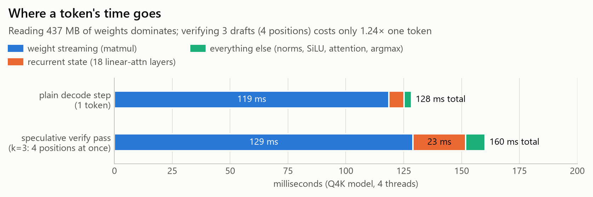
</picture>

Profile of the vectorized engine (`PF_FWD_STATS=1 PF_KERN_STATS=1`; `engine/CORE.md` "Final"; the
profiled runs are ~2% slower, so the totals are the clean bench `pinfer-core2-q4k_20261022_020959`):

| Per plain decode step | ms | Per verify pass, n = 4 (k = 3) | ms |
|---|---|---|---|
| Matmuls (weight streaming) | 118.6 | Matmuls | ~129 |
| Recurrence kernel | 6.5 | Recurrence kernel (incl. its scratch copy of the state) | 22.8 |
| Attention (6 layers) | 1.10 | Attention | 2.87 |
| Conv + L2 norm + gates | 1.05 | Conv + L2 norm + gates | 2.37 |
| Norms, residual adds, MLP SiLU, gated norm, argmax | 1.05 | Log copies, MLP SiLU, gated norm, norms | 3.18 |
| **Step (clean bench)** | **128.0** | **Pass (clean bench)** | **158.8** |

The DRAM floor for a decode step is 473 MB (437 MB of weights + 36 MB of recurrent-state traffic) at
4.2 GB/s ≈ 113 ms, about 12% below the measured step (`engine/bench/KERNELS.md` Part 2, `notes.md`).
That estimate counts the whole file; the MTP head (11.5 MB) is read only when drafting, so a plain step
streams 424.9 MB of weights (tensor directory of the `.pq` file, `tools/make_figures2.py`):

<picture>
  <source media="(max-width: 600px) and (prefers-color-scheme: dark)" srcset="figures/bytes_per_token-mobile-dark.png">
  <source media="(max-width: 600px)" srcset="figures/bytes_per_token-mobile.png">
  <source media="(prefers-color-scheme: dark)" srcset="figures/bytes_per_token-dark.png">
  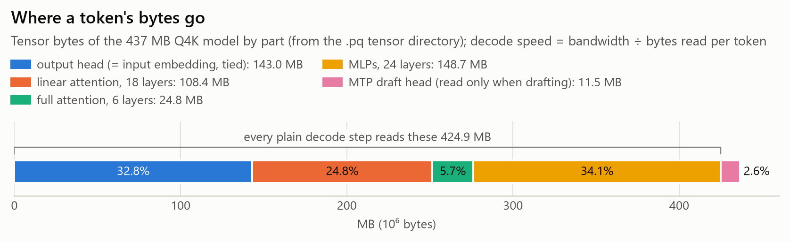
</picture>

**How the speed was built up**, one verified step at a time:

<picture>
  <source media="(max-width: 600px) and (prefers-color-scheme: dark)" srcset="figures/progress-mobile-dark.png">
  <source media="(max-width: 600px)" srcset="figures/progress-mobile.png">
  <source media="(prefers-color-scheme: dark)" srcset="figures/progress-dark.png">
  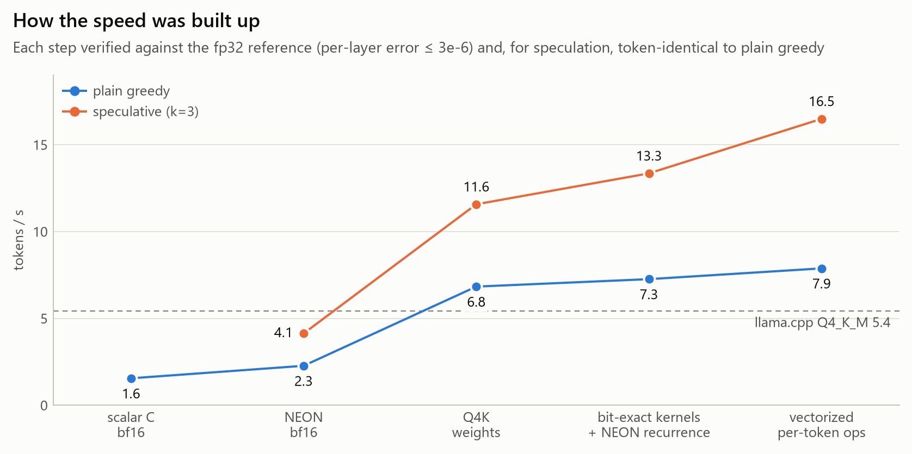
</picture>

| Step | Plain | Speculative | File |
|---|---|---|---|
| Scalar C, bf16, 1 thread (10-token prompt, 32 generated) | 1.55 | — | `pinfer-ref-bf16_20261021_214710` |
| NEON bf16, 4 threads | 2.27 | 4.13 (k=2) | `pinfer-spec-fast-k0_20261021_231307`, `pinfer-spec-fast2-dickens64-k2-v32768_20261021_234027` |
| Q4K weights | 6.83 | 11.57 (k=3) | `pinfer-fast-q4k-headq4k_20261022_001957` |
| Bit-exact kernels + NEON recurrence (`af06041`) | 7.26 | 13.35 (k=3) | `pinfer-final-q4k_20261022_011230` |
| Vectorized per-token ops (`fba8a1a`) | 7.88 | 16.49 (k=3) | `pinfer-final2-q4k_20261022_023950` |

## 8. Kernels and memory bandwidth

<picture>
  <source media="(max-width: 600px) and (prefers-color-scheme: dark)" srcset="figures/kernel_bandwidth-mobile-dark.png">
  <source media="(max-width: 600px)" srcset="figures/kernel_bandwidth-mobile.png">
  <source media="(prefers-color-scheme: dark)" srcset="figures/kernel_bandwidth-dark.png">
  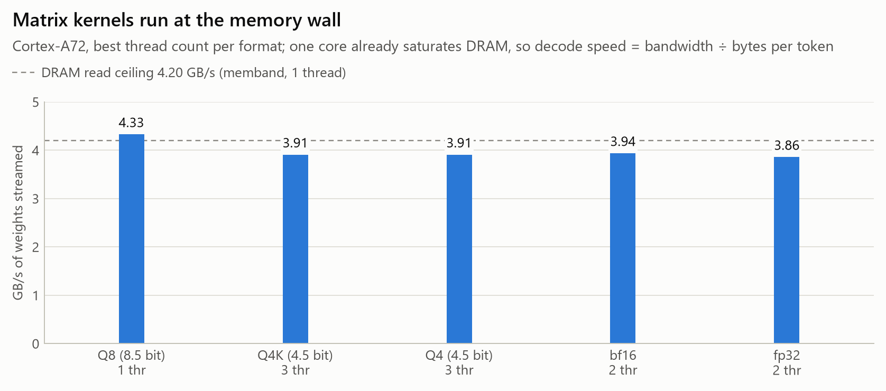
</picture>

`memband` (256 MB streaming read): 4.20 / 4.08 / 4.07 GB/s with 1 / 2 / 4 threads
(`memband_20261021_210615`). One core saturates DRAM.

Best matvec kernel per dtype (n = 1, cold weights, real Qwen3.5 shapes; `kbench-v9-final_20261021_232530`,
709 configurations, 0 noisy; `engine/bench/KERNELS.md`):

| Dtype | Bits/weight | Best threads | GB/s | % of memband | 1-thread GB/s | 1-core limit |
|---|---|---|---|---|---|---|
| F32 | 32 | 2 | 3.73–3.86 | 89–92% | 3.66–3.81 | DRAM |
| BF16 | 16 | 2 | 3.79–3.94 | 90–94% | 3.47–3.57 | SHLL + FMLA compute |
| Q8_G32 | 8.5 | 1 | 4.23–4.33 | 101–103% | same | DRAM |
| Q4_G32 | 4.5 | 3 | 3.85–3.91 | 92–93% | 2.66–2.73 | NEON issue, ~40 cycles / 64 B |
| Q4K_G32 | 4.5 | 2–3 | 3.84–3.91 | 91–93% | 2.30–2.35 | NEON issue, ~47 cycles / 64 B |

Output head (248,320 × 1024) per token: Q4 / Q4K 36.7 ms, Q8 62.5 ms, BF16 129 ms. Q8 exceeds memband
slightly because kbench rotates through a 64 MB arena while memband streams 256 MB once. Batched rows
equal single-vector results bit for bit in all 588 checked configurations
(`kbench-v11-exact_20261022_004156`). Failed ideas with numbers (software prefetch −22% for Q8 on one
thread, 8-wide passes, two accumulators per row): `engine/bench/KERNELS.md` "What did not work".

## 9. Quantization error

Relative RMS weight error ‖W − Q(W)‖ / ‖W‖ in %, on the real Qwen3.5-0.8B weights
(`tools/quant.py report`; `logs/quant/quant_error_report_v2.txt`, `.json`):

| Tensor type | Q8_G32 (8.5 b) | Q4_G32 (4.5 b) | Q4K_G32 (4.5 b) |
|---|---|---|---|
| `embed_tokens` (= tied head) | 0.541 | 8.453 | 7.452 |
| `linear_attn.in_proj_qkv` | 0.537 | 8.408 | 7.474 |
| `linear_attn.out_proj` | 0.552 | 8.644 | 7.616 |
| `mlp.gate_proj` / `up_proj` / `down_proj` | 0.536 / 0.534 / 0.539 | 8.392 / 8.353 / 8.435 | 7.463 / 7.446 / 7.481 |
| `self_attn.q_proj` / `k_proj` | 0.539 / 0.555 | 8.443 / 8.693 | 7.498 / 7.659 |
| `self_attn.v_proj` / `o_proj` | 0.603 / 0.569 | 9.415 / 8.914 | 8.051 / 7.778 |
| `mtp.fc` | 0.877 | 11.660 | 9.071 |

Q4K is 11–22% lower error than Q4 at the same 4.5 bits; perplexity (§5) confirms that the gap matters.
The figure plots one rounded value per format next to its perplexity.

<picture>
  <source media="(max-width: 600px) and (prefers-color-scheme: dark)" srcset="figures/quantization-mobile-dark.png">
  <source media="(max-width: 600px)" srcset="figures/quantization-mobile.png">
  <source media="(prefers-color-scheme: dark)" srcset="figures/quantization-dark.png">
  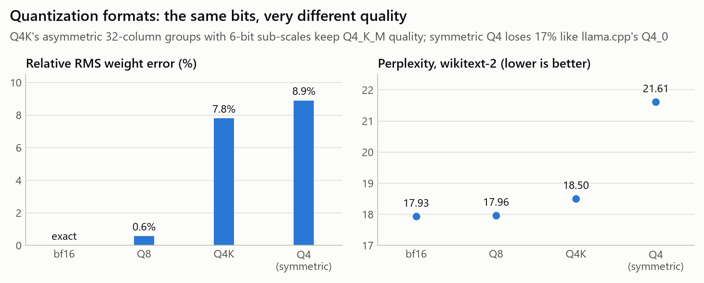
</picture>

## 10. OS experiment

Same binary (`pinfer_run_fast` at `af06041`; the K3 rows used `pinfer_run_thp`, which adds the opt-in
`PINFER_HUGEPAGES`) and model, 64 + 64 tokens, one-time `tryboot`s of the custom kernel 6.18.50-pinfer
(`notes.md` "Custom kernel", `os/kernel/KERNEL.md`):

| Condition | memband 1 / 2 / 4 threads, GB/s | Plain | Speculative k=3 | Files |
|---|---|---|---|---|
| K0: stock kernel | 4.20 / 4.08 / 4.07 | 7.26 | 13.35 | `memband_20261021_210615`, `pinfer-final-q4k_20261022_011230` |
| K1: custom kernel, stock cmdline | 4.20 / 4.18 / 4.29 | 7.28 | 13.51 | `memband-k1-pinfer-kernel_20261022_012647`, `pinfer-k1-pinfer-kernel-q4k_20261022_012707` |
| K2: + `isolcpus`, `nohz_full`, `rcu_nocbs` on cores 1–3 | 4.36 / 4.19 / 4.60 | 7.21 | 13.45 | `memband-k2-splitcore_20261022_012836`, `pinfer-k2-splitcore-q4k_20261022_012856` |
| K3: weights in 2 MB THP pages (`PINFER_HUGEPAGES=1`, 428 of 437 MB huge) | — | 7.27–7.34 | 13.42 | `pinfer-k3b-thp-q4k_20261022_013420`, `pinfer-k3c-thp-q4k-repeat_20261022_013443` |
| K3 control: same kernel, no THP | — | 7.24–7.30 | 13.52 | `pinfer-k3a-nothp-q4k_20261022_013400`, `pinfer-k3c-thp-q4k-repeat_20261022_013443` |

All within 1%: the engine is DRAM-bound and the A72 already hides the TLB cost of a sequential stream.
16 KB pages are impossible on this core (no 16 KB granule, `os/kernel/KERNEL.md` §9). The first run after
each reboot shows prefill ~20 instead of ~27 tok/s (cold page cache), which led to the `--bench` warm-up.

<picture>
  <source media="(max-width: 600px) and (prefers-color-scheme: dark)" srcset="figures/os_experiment-mobile-dark.png">
  <source media="(max-width: 600px)" srcset="figures/os_experiment-mobile.png">
  <source media="(prefers-color-scheme: dark)" srcset="figures/os_experiment-dark.png">
  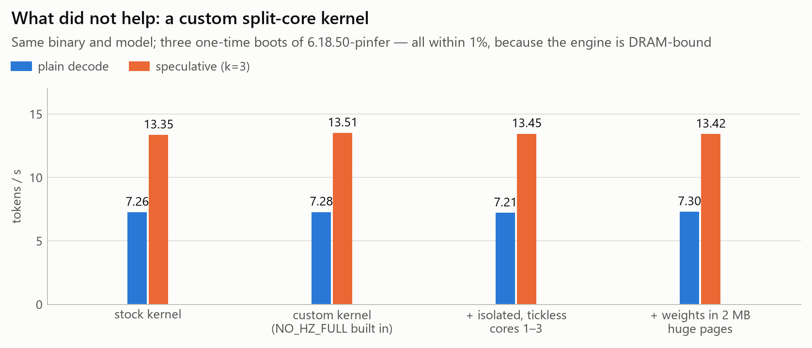
</picture>

## 11. Standard runtimes per thread count

Source tables and failure notes: `bench/BASELINES.md`, `notes.md`.

| Runtime, format | Decode tok/s, 1 / 2 / 3 / 4 threads | Prefill tok/s, 1 / 2 / 3 / 4 threads | Peak RSS |
|---|---|---|---|
| llama.cpp Q4_0 | 2.32 / 4.20 / 5.58 / 5.59 | 4.28 / 8.33 / 12.08 / 15.68 | — |
| llama.cpp Q4_K_M | 2.26 / 4.06 / 5.38 / 5.41 | 4.03 / 7.84 / 11.35 / 14.82 | — |
| llama.cpp Q8_0 | 2.83 / 4.12 / 4.04 / 3.60 | 4.73 / 9.22 / 13.22 / 17.06 | — |
| MNN 3.6.1 int4 | 4.11 / 6.67 / 6.56 / 6.31 | 9.81 / 18.54 / 23.67 / 30.94 | 894 MB |
| ORT GenAI 0.18 int4 (acc. level 4) | 0.84 / 1.64 / 2.36 / 3.10 | 5.14 / 9.38 / 10.96 / 9.86 | 783 MB |

llama.cpp decode stops scaling at 3 threads for 4-bit and gets slower beyond 2 threads at 8 bits (memory
contention); its prefill scales with threads (compute-bound). ORT int4 decode scales linearly, so it is
compute-bound on the A72. Invalid or aborted runs, kept for the record: ORT int8 (killed after 38 min,
`ort-qwen35-0.8b-int8-acc4_20261021_230818`), ORT accuracy level 1 (symlinked data rejected,
`ort-qwen35-0.8b-int{4,8}-acc1_*`).

## 12. Correctness record

| Check | Result | Evidence |
|---|---|---|
| Engine vs fp32 transformers reference (host) | worst per-layer rel. error 2.87e-6 scalar, 3.19e-6 with NEON ops; greedy 32/32 | `tests/test_golden.py`, `engine/CORE.md` §1 and round 1 |
| Same on the Pi (bf16) | greedy 32/32 | `engine/CORE.md` "Rules kept throughout" |
| MTP head vs PyTorch reference | rel. error ≤ 3.9e-6 on 13 rows, identical argmax | `tests/test_spec.py`, `logs/spec/test_spec_20261021_221629.log` |
| Speculative == plain, host (scalar) | 63/63 runs: 9 prompts × 7 configurations | `engine/SPEC.md` §3.3 |
| Speculative == plain, Pi (NEON) | 16/20 before the fix, 20/20 in every run since | `spec-exact-old_20261022_004457`; `spec-exact-{lin,v11,final,core2 ×3,final2,ctx}_20261022_*` |
| Batched kernel == single-vector kernel | 588/588 configurations | `kbench-v11-exact_20261022_004156` |
| New attention path == old path | 5/5 identical dumps | `ctx-check_20261022_025513` |
| State save → restore → continue | 9/9 identical (host) | `tests/test_state.py`, `engine/CONTEXT.md` §6 |
| Python package | 80/80 on host and Pi | `logs/release/host_pytest_final.log`, `logs/release/pi_pytest_final.log`; fast wheel: `docs/journal/2026-10-22.md` |

Note that `valid=true` describes the measurement conditions, not the outcome: the 16/20 run above is
`valid=true`. Read correctness from each tool's own fields (`match`, `exact`, `identical`).

## 13. Figures

All rendered from the records by `tools/make_figures.py` (data from `notes.md`) and
`tools/make_figures2.py` (data from the lab notebooks), shared style `tools/figstyle.py`. Each figure
exists in four files: `<name>.png` and `<name>-dark.png` for desktop (1676 px, twice GitHub's 838 px
column) and `<name>-mobile.png` / `<name>-mobile-dark.png` for phones (1080 px, three times a 360 px
column); the pages pick one with `<picture>` by colour scheme and by `max-width: 600px`.

| Figure | Shows | Tables |
|---|---|---|
| `figures/decode_speed.png` | Decode tok/s by engine, plain and speculative | §1 |
| `figures/speed_vs_quality.png` | Speed against perplexity | §1, §5 |
| `figures/speculative_k.png` | Tokens per pass and tok/s by k | §3 |
| `figures/speculative_schematic.png` | One draft / verify / accept round | [ARCHITECTURE.md §6](ARCHITECTURE.md#6-exact-speculative-decoding) |
| `figures/mtp_acceptance.png` | Acceptance per draft position and the two controls | §3 |
| `figures/prefill_speed.png` | Prefill by engine | §4 |
| `figures/context_length.png` | Speed vs context, before the attention rewrite | §6 |
| `figures/step_breakdown.png` | Time per decode step and verify pass | §7 |
| `figures/bytes_per_token.png` | Bytes of the Q4K model by part | §7 |
| `figures/progress.png` | Speed after each optimization step | §7 |
| `figures/kernel_bandwidth.png` | Kernel GB/s against memband | §8 |
| `figures/quantization.png` | Weight error and perplexity per format | §9 |
| `figures/os_experiment.png` | Custom-kernel experiment | §10 |
