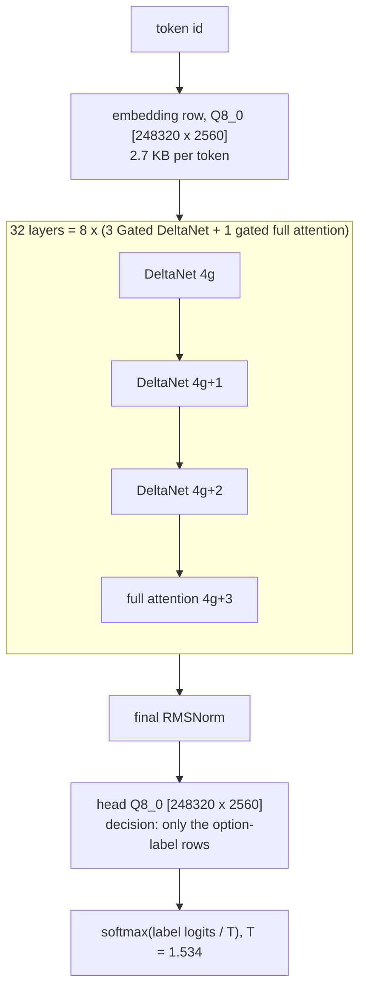

# Network audit: where the time goes, and what can still be made faster

Audit of 2026-10-22 (KST), branch `worktree-agent-a4e27a8ffe358907e` from main `2ebc642`. Subject, as the
owner asked: the network Cerno 4B runs on the Pi (Qwen3.5-4B architecture, prefill only), in depth;
Qwen3.5-0.8B second. All Pi numbers are at **1.5 GHz** (`freq_khz` 1500000 in every cited result), 4 threads,
governor `ondemand`. Result files are in `bench/results/` of this repository unless the path says
`cerno-pi/` (the separate Cerno repository, `E:\Personal_tries\cerno-pi\results\`). Analysis scripts:
`tools/audit/` (each prints the numbers it is cited for).

Exactness classes used throughout: **(a)** bit-identical to the current output; **(b)** output-changing,
opt-in only, with a stated quality check; **(c)** needs an owner decision.

## 0. Summary

- **A Cerno decision costs about 150 ms per token, and 93% of that is the Q4_0 matrix kernel running
  compute-bound** at 50–55 GOP/s, i.e. 93–98% of the best rate the kernel reaches on the same shape in
  isolation and 50–55% of the A72's int8 instruction peak (96 GOP/s). Everything else per token (DeltaNet
  recurrence 5.9 ms, attention 1.7 ms, norms and activations 3.1 ms) is 7%; the snapshot, restores and
  Python together are about 1% of a decision. The 52 questions of the Cerno set spend 38% of the time on
  the shared state prefix and 61% on the question rows.
- **Nothing in the token count can be removed exactly.** The rows' common prefix (`"Context:\n" + state +
  "\n\nQuestion:"`) is already prefilled once and snapshotted. 44% of a question's own tokens are
  template (`"\nOptions:"`, `"\n(A)"`…, `"\nAnswer: ("`), but they come after the question text, so their
  state depends on it; moving them is a prompt-layout change (class c).
- **The largest exact lever is the clock.** At 2.0 GHz (approved; the lead's test window opened at
  17:39) a decision should take about 21 s instead of 27.6 s (estimate 1.27–1.33× from the compute-bound
  budget, §6). With speed4b's kernels (−4.4% per decision, measured) and a C-side state checkpoint
  (−1 to −1.5%, plus memory for long states) the exact path ends near **20 s per decision (−26 to −29%)**.
- **Beyond that, gains need a faster inner loop.** Exact micro-variants of the Q4 loop have been tried
  (KERNELS.md Part 3, speed4b); what remains open is lut's in-order-dispatch lead (float work on the second
  NEON pipe, floor ~16 instead of 28–30 cycles per block-vector; being measured), the toolchain and GPU
  co-processing studies (running), and class (b) arithmetic (numerics: ≤ 7-bit activations for Winograd
  pairs, −6%; integer sub-scales, −12 to −15%, which would change Cerno's published weights).
- **0.8B** (now regression-only for the optimization agents, lead 17:52): plain decode is 87–88% of its
  DRAM floor; the 143 MB head cannot be read exactly in part (measured: bound-based screening keeps 100% of the
  rows, §4.2 D2); the clock helps prefill (+27–33%) and the verify pass (k = 4 prose +15–20%), not plain
  decode (+2–4%).

Top recommendations, in order (details §7):

| # | What | Class | Cerno decision (27.6 s median) | 0.8B effect |
|---|---|---|---|---|
| 1 | Run the approved 2.0 GHz test (window opened 17:39), then decide on the clock | (a) if the gates pass | → ~21 s (−21 to −25%) | prefill +27–33%, k = 4 prose +15–20%, chat +4–6%, plain +2–4% |
| 2 | Merge speed4b (prefill tail + groups of 7s and 5s) | (a), measured | −4.4% | prefill 43.8 → 45.1 tok/s, decode unchanged |
| 3 | C-side state checkpoint: no Python copies, restore keeps the prefix KV rows in place | (a) | −1 to −1.5%; long states fit (3.5k → ~17k tokens) | `pinfer chat` / serve snapshots: same |
| 4 | Follow lut's dispatch-pairing result; if real, rebuild the Q4 / Q4K loop around it | (a) | up to −30% if the ~16-cycle floor is approached (unmeasured) | prefill and verify likewise |
| 5 | Opt-in numerics only with the 52-question check (§4.3) | (b) | −6 to −15% (numerics' estimates) | same order on prefill |

## 1. Cerno 4B on the Pi: the network and how a decision drives it

### 1.1 The layers
Cerno 4B is a Qwen3.5-4B-Base fine-tune (cerno-pi `CERNO.md` §2): hidden 2560, MLP 9216, vocabulary
248,320, 32 layers, **no MTP head**. The layer order repeats 8 times: three Gated DeltaNet (linear
attention) layers, then one gated full-attention layer, so the full-attention layers are **3, 7, 11, 15,
19, 23, 27, 31** (mask `0x88888888`) and the other 24 are DeltaNet. Every layer is pre-norm with two
residual adds and a SwiGLU MLP. Weights: the published Q4_0 GGUF converted bit for bit (`Q4_G32` in
pinfer, 4.5 bits per weight); `token_embd` and the untied `output` head are Q8_0 (8.5 bits).

| Part | Shape (rows x cols) | Weights per layer | MMAC per token | Notes |
|---|---|---|---|---|
| **DeltaNet layer** (24) | | **63.50 MB** | **112.9** | |
| `in_proj_qkv` | 8192 x 2560 | 11.80 MB | 20.97 | q, k: 16 heads x 128; v: 32 heads x 128 |
| `in_proj_z` | 4096 x 2560 | 5.90 MB | 10.49 | output gate, 32 heads x 128 |
| `in_proj_a`, `in_proj_b` | 2 x (32 x 2560) | 0.09 MB | 0.16 | decay and beta per V head |
| conv1d + SiLU | depthwise, kernel 4, 8192 channels | F32, small | — | state 3 x 8192 fp32 per layer (2.25 MiB in all) |
| gated delta rule | 32 V heads, state 128 x 128 fp32 each | — | 88 MFLOP per token over 24 layers | 2 MiB of state per layer, 48 MiB in all; each K head feeds 2 V heads |
| gated RMSNorm x SiLU(z) | 32 heads x 128 | — | — | |
| `out_proj` | 2560 x 4096 | 5.90 MB | 10.49 | |
| MLP `gate`, `up` | 2 x (9216 x 2560) | 26.54 MB | 47.19 | |
| MLP `down` | 2560 x 9216 | 13.27 MB | 23.59 | |
| **Full-attention layer** (8) | | **60.46 MB** | **107.5** | |
| `q_proj` (query + gate) | 8192 x 2560 | 11.80 MB | 20.97 | 16 heads x (256 + 256) |
| `k_proj`, `v_proj` | 2 x (1024 x 2560) | 2.95 MB | 5.24 | 4 KV heads x 256 (GQA 4:1) |
| q/k norm, RoPE (64 of 256 dims, θ 1e7), causal softmax, sigmoid gate | | — | grows with context | KV cache 8 KiB per layer and token (fp32), 64 KiB over the 8 layers |
| `o_proj` | 2560 x 4096 | 5.90 MB | 10.49 | |
| MLP | as above | 39.81 MB | 70.78 | |
| **Body, per token** | | **2007.6 MB** | **3569 (7.14 GOP)** | |
| Head (full vocabulary) | 248320 x 2560, Q8_0 | 675.4 MB | 635.7 | a decision reads only the 4-row tiles of its labels: 10.9 KB per tile |

Source: `python tools/audit/shapes.py` (shapes from the `.pq` header; the body total equals the
2007.6 MB of Q4_0 tensors in `CERNO.md` §2).

### 1.2 What one prefill token costs, per layer
Main (`pinfer_run_cerno2` = `csp0`), 256-token prefill in 64-token chunks with `PF_KERN_STATS` and
`PF_FWD_STATS`, per token (`tools/audit/budget.py 4b cerno-speed-profile1_20261022_171543.json --block 1`):

| Layer kind | Matmuls | Mixer | Norms, conv, activations | Total per layer | x layers |
|---|---|---|---|---|---|
| DeltaNet | 4.40 ms (qkv 0.79, z 0.40, a/b 0.02, out 0.42, MLP 2.78) | recurrence 0.24 ms | 0.11 ms | **4.75 ms** | x 24 = 114.1 ms |
| Full attention | 4.19 ms (q 0.79, k/v 0.21, o 0.42, MLP 2.78) | attention 0.22 ms | 0.06 ms | **4.46 ms** | x 8 = 35.7 ms |
| Head + embedding (amortized over 256 tokens; a decision skips the full head) | | | | | 0.9 ms |
| **Prefill token** | | | | | **150.7 ms (6.63 tok/s)** |

The MLP alone is 59% of a token (88.9 of 150.7 ms). The 8 full-attention layers cost less than the
DeltaNet ones because their projections are smaller (k/v 2 x 1024 rows instead of z + a + b) and
attention over a few hundred tokens is cheap.

### 1.3 How a decision drives the network
`cerno_pi/decide.py` (`Decider.decide`), reproducing Cerno's llama.cpp engine:

1. **Rows.** One row per question: `"Context:\n" + state + "\n\nQuestion: <instructions>\nOptions:\n(A) <opt>
   …\nAnswer: ("`. Up to 10 options are lettered A..J and the row is tokenized as one string; more
   options get one label token each. JSON states are serialized with indices on long arrays; states are
   cut at 16,384 tokens.
2. **Shared prefix.** The longest common prefix (LCP) of all rows is prefilled once
   (`eval_select(prefix, [])`, no logits) and snapshotted (`save_state`: conv and recurrent state 50.3 MB
   plus the prefix's K/V rows, 64 KiB per token). On the set the LCP always ends at `"\n\nQuestion:"`
   (support_triage: 15 tokens = `"Context:\n"` 3 + 9 state tokens + `"\n\nQuestion:"` 3); the question
   texts already differ at their first token.
3. **Questions.** The first question continues from the live state; each later one first restores the
   snapshot (`load_state`). The question's suffix (median 36 tokens for later questions; 20–110 on the
   set) is prefilled as one chunk in groups of at most 7 tokens per weight read, so the 2.0 GB body is
   streamed 4–7 times per question (27–48 tokens).
4. **Readout.** For the last position only, the final norm and the head rows of the option labels
   (`pinfer_eval_select`: the 4-row Q8 tiles that hold the label ids, ~11 KB each) give the label logits;
   `p = softmax(logits / T)` with T = 1.534 from `decider_config.json`. This equals the reference's
   renormalized `p^(1/T)` over llama-server's top-260 probabilities, except that a label outside the top
   260 would count as 0 there (never on the set; bit-identical to the full-head path, `CERNO.md` §5).

So the network runs as a pure prefill: ~150 ms for every token of the prefix and of every question,
plus a fixed cost per decision (snapshot) and per question (restore, readout).

## 2. Time budgets

Roofs: DRAM 4.20 GB/s (`memband_20261021_210615.json`, 1 thread); int8 instruction peak 96 GOP/s (one
8-MAC `SMULL`/`SMLAL` per cycle on pipe F0, 4 cores, 1.5 GHz; `docs/ARCHITECTURE.md` §9); **kernel roof** =
the best cold 4-thread kbench time of the same shape at one 7-vector group (`cerno-speed-kb0_20261022_160055.json`,
`cerno-speed-kb5-passes_20261022_163146.json`; `tools/audit/kbtable.py`); fp32 NEON roof 24 GFLOP/s (one
4-lane operation per cycle and core, multiply and add separate as the exact code does). "MB" = bytes read
from DRAM per token: in a prefill each group of ≤ 7 tokens re-reads the weights (10 groups per 64-token chunk).

### 2.1 Cerno 4B prefill, per token
`cerno-speed-profile1_20261022_171543.json`, block 1 (main, `csp0`, p256); block 0 is the speed4b build.

| Operation | MB | MMAC | ms | Achieved | Roof | % of roof | % of int8 peak |
|---|---|---|---|---|---|---|---|
| MLP gate + up (32 layers, 9216 x 2560) | 132.7 | 1509.9 | 57.10 | 52.9 GOP/s | 54.8 (kernel) | 97% | 55% |
| MLP down (32, 2560 x 9216) | 66.4 | 755.0 | 31.76 | 47.5 | 51.4 | 93% | 50% |
| DeltaNet in_proj_qkv (24, 8192 x 2560) | 44.2 | 503.3 | 18.91 | 53.2 | 56.4 | 94% | 55% |
| attention q_proj + gate (8, 8192 x 2560) | 14.8 | 167.8 | 6.30 | 53.2 | 56.4 | 94% | 55% |
| DeltaNet out_proj (24, 2560 x 4096) | 22.1 | 251.7 | 10.06 | 50.0 | 53.9 | 93% | 52% |
| attention o_proj (8, 2560 x 4096) | 7.4 | 83.9 | 3.35 | 50.0 | 53.9 | 93% | 52% |
| DeltaNet in_proj_z (24, 4096 x 2560) | 22.1 | 251.7 | 9.49 | 53.1 | 55.7 | 95% | 55% |
| attention k_proj + v_proj (8, 1024 x 2560) | 3.7 | 41.9 | 1.67 | 50.4 | 48.3 | 104% | 52% |
| DeltaNet in_proj_a + b (24, 2 x 32 x 2560) | 0.4 | 3.9 | 0.41 | 19.3 | 19.7 | 98% | 20% |
| **all matmuls** | **313.7** | **3569** | **139.98** | **51.0 GOP/s; DRAM 2.24 GB/s** | | **94%** (kernel), 53% (DRAM) | **53%** |
| DeltaNet recurrence `lin_rule` | state in L1/L2 | 88 MFLOP | 5.87 | 15.0 GFLOP/s | 24 GFLOP/s (fp32) | 63% | — |
| full attention (K/V store, scores, softmax, P·V) | < 1 | small | 1.72 | — | — | — | — |
| MLP SiLU x up | — | — | 0.97 | — | — | — | — |
| conv1d + L2 norm + gates | — | — | 0.95 | — | — | — | — |
| RMSNorms + residual adds | — | — | 0.81 | — | — | — | — |
| gated RMSNorm | — | — | 0.41 | — | — | — | — |
| head (full, once per run) + embedding | 2.6 | 2.5 | 0.92 | — | — | — | — |
| **wall** | | | **150.7 (6.63 tok/s)** | | | | |

Reading: every matmul shape runs at 93–98% of what the kernel reaches alone, so the in-engine overhead
(barriers, activation quantization, cache pollution by the other phases) is about 6% of the matmul time.
DRAM carries 2.2 GB/s, about half of its roof: the prefill is **compute-bound in the kernel's inner loop**.
The 32-row a/b projections are the only inefficient shape (too few tiles for 4 threads) and cost 0.3%.
speed4b's build (block 0): 145.5 ms per token, matmul 134.9 ms (−3.6%), other phases unchanged.

### 2.2 One Cerno decision
All 18 requests of sets A + B (52 questions) with state reuse, main build
(`cerno-pi/results/cerno-decide-reuse-a2_20261022_152103.json`, `-b2_20261022_152644.json`;
`python tools/audit/cerno_rows.py <both files>`):

| Part | Tokens | Seconds (sum of 18) | Share | Per token or per event | Bound by |
|---|---|---|---|---|---|
| shared prefix prefill (state + `"Context:"`, `"Question:"`) | 1435 | 215.7 | 38.1% | 150.3 ms per token | Q4_0 kernel compute |
| question rows: prefill of the suffixes | 2268 | 339.3 | 60.0% | 149.6 ms per token (fit) | Q4_0 kernel compute |
| question rows: fixed part (restore, readout, Python per row) | — | 5.5 | 1.0% | ~0.1 s per row (fit; first and later rows alike) | memcpy, Python |
| snapshot (`save_state` in Python) | — | 4.5 | 0.8% | 0.24 s median per decision | 4 copies of a ~51 MB blob |
| rendering, tokenization, Python glue | — | 0.5 | 0.1% | 0.02 s per decision | — |
| **total** | **3703** | **565.5** | | **mean 31.4 s, median 27.7 s per decision** | |

The joint fit (`seconds = 149.6 ms x tokens + 0.115 s` for first rows, `+ 0.102 s` for later rows) shows
that a restore is not measurable against the per-row noise: well below 0.1 s, i.e. < 2% of a later
question (5.5 s median for 36 tokens). Example, code_review (3 questions): 22.6 s = prefix 53 tokens in
7.70 s + snapshot 0.24 s + rows of 26 / 34 / 39 tokens in 3.83 / 5.01 / 5.84 s.

**Template share (the lead's question).** Of the 2268 question-suffix tokens, 1003 (44%) are template
(`"\nOptions:"` 3, then `"\n"`, `"(X"`, `")"` per option, `"\nAnswer: ("` 4), 547 (24%) the question text
and 718 (32%) the option texts. The template is 27% of all tokens of a decision, but none of it can move
into the snapshot exactly: each template token follows the question text, so the K/V rows, conv state
and DeltaNet state it produces depend on that question. What every row shares is already in the snapshot.

### 2.3 Qwen3.5-0.8B plain decode step
Per-shape `PF_KERN_STATS` / `PF_FWD_STATS` of 63 plain steps, prompt64
(`ver-before-profile_20261022_065138.json`, run 1; `tools/audit/budget.py 08b … --stderr --block 0 --n 1
--tokens 63`). That binary (`9d30bbda`) has the same n = 1 kernels and per-token code as main for plain
steps (the later rounds changed batched passes and the verify path); profiled 8.01 tok/s, main 7.89
(`speed-ab-merge4_20261022_103609.json`). A fresh profile with the 0.2.0 binary (`audit-08b-profile`)
was queued but did not run (§8).

| Operation | MB | MMAC | ms | GB/s | % of DRAM roof |
|---|---|---|---|---|---|
| head, Q4K 248320 x 1024 | 143.0 | 254.3 | 36.3 | 3.94 | 94% |
| MLP gate + up (24) | 99.1 | 176.2 | 25.6 | 3.88 | 92% |
| DeltaNet in_proj_qkv (18) | 63.7 | 113.2 | 16.3 | 3.90 | 93% |
| out_proj (18) + o_proj (6), 1024 x 2048 | 28.3 (+ 18.9 state write-back) | 50.3 | 13.6 | 2.08 (3.46 incl. write-back) | 49% (82%) |
| MLP down (24) | 49.6 | 88.1 | 12.9 | 3.84 | 91% |
| DeltaNet in_proj_z (18) | 21.2 | 37.7 | 5.5 | 3.84 | 92% |
| q_proj + gate (6) | 14.2 | 25.2 | 3.6 | 3.88 | 92% |
| k_proj + v_proj (6) | 3.5 | 6.3 | 0.9 | 3.79 | 90% |
| in_proj_a + b (18, 16 rows) | 0.3 | 0.6 | 0.25 | 1.32 | 31% |
| **all matmuls** | **423.2** | **752** | **115.1** | **3.68** | **88%** |
| DeltaNet recurrence (18.9 MB state read; written back during out_proj) | 18.9 | 33 MFLOP | 6.45 | 2.93 | — |
| conv + L2 norm + gates | — | — | 1.04 | | |
| attention (6 layers, 64-token context) | 1.5 | — | 1.11 | | |
| MLP SiLU x up, norms + adds, gated norm | — | — | 0.83 | | |
| argmax over 248,320 logits | 1.0 | — | 0.23 | | |
| **step** | **462.7 incl. state** | | **124.8 (8.01 tok/s); main 126.7** | **3.70** | **88% of the 110.2 ms floor** |

The step is DRAM-bound. Every weight stream runs at 90–94% of the roof except out_proj, which absorbs the
recurrence's write-back of 1 MiB of dirty state per layer (KERNELS.md Part 2, dirty-L2 experiment).

### 2.4 Qwen3.5-0.8B speculative round, k = 4 (prompt64, draft vocabulary 32768)
`mm2-e2e-decode_20261022_140420.json` (medians of 3): 18.64 tok/s, 3.94 tokens per round. Verify split
estimated from kbench n = 5 per shape (`mm2-kbench-final_20261022_141346.json`) plus the measured n = 4
engine profile (`mm2-kstats-k3_20261022_140749.json`: n = 4 matmuls 134.6 ms per pass, verify 153.3 ms).

| Part | Bytes | Ops | ms per round | Roof | % of roof |
|---|---|---|---|---|---|
| verify pass, 5 positions: matmuls (estimated ~151 ms: head 47.1, layers ~104 incl. write-back) | 424.9 MB once | 7.52 GOP | 176.4 in all | compute: 7.52 GOP / 54.6 GOP/s = 138 ms (DRAM 110 ms) | 78% |
| verify pass: recurrence on 4 draft copies + log, attention, conv, norms (estimated) | 18.9 MB state + logs | — | (~25 of the 176.4) | | |
| MTP: 3 chained drafts + 1 pass over the accepted rows | ~4 x 30 MB (MTP layer 11.5 MB + draft head 18.9 MB) | small | 32.9 (8.2 each) | DRAM: 4 x 7.2 ms = 28.8 | 88% |
| commit (argmaxes, deferred replay bookkeeping) | — | — | 2.1 | | |
| **round** | | | **211.4 → 53.7 ms per token** | | |

### 2.5 Qwen3.5-0.8B prefill, per token (64-token chunk, groups of 7)
`mm2-kstats-k3_20261022_140749.json` (`pinfer_run_mm2` = the 0.2.0 kernels, n = 64 rows of two
prefills); wall from `mm2-e2e-prefill_20261022_140719.json` (43.1 tok/s).

| Operation | MB from DRAM | MMAC | ms | GOP/s | % of the 54.6 GOP/s kernel roof |
|---|---|---|---|---|---|
| MLP gate + up | 15.5 | 176.2 | 6.56 | 53.7 | 98% |
| DeltaNet in_proj_qkv | 10.0 | 113.2 | 4.00 | 56.6 | 104% |
| MLP down | 7.7 | 88.1 | 3.69 | 47.7 | 87% |
| out_proj + o_proj | 4.4 | 50.3 | 2.15 | 46.8 | 86% |
| in_proj_z | 3.3 | 37.7 | 1.35 | 55.9 | 102% |
| q_proj + gate | 2.2 | 25.2 | 1.05 | 48.0 | 88% |
| k + v, a + b | 0.6 | 6.9 | 0.44 | — | — |
| **all matmuls** | **43.7** | **498** | **19.24** | **51.8** | **95%** |
| recurrence (n = 64, chunk in L1), conv, norms, attention, head once | — | — | ~4.0 | | |
| **token** | | | **23.2 (43.1 tok/s); speed4b 45.1** | | |

### 2.6 Qwen3.5-0.8B decode at a 4096-token context
`engine/CONTEXT.md` §3c and §9 (`pinfer-profile-kv{0,1}-ctx4096_*`, `att3-final-ab-ctx2048-4096_20261022_100706.json`,
`att3-final-abench_20261022_101116.json`):

| Part | fp32 K/V (default) | fp16 K/V (opt-in) |
|---|---|---|
| step | 155.6 ms (6.43 tok/s) | 145.7 ms (6.86 tok/s) |
| the 64-context step (weights, recurrence, rest) | ~126.7 ms | ~126.7 ms |
| attention, 6 layers | ~29 ms; K/V 96 MB at ~3.3 GB/s (79% of the DRAM roof) | ~19 ms; 48 MB at ~2.5 GB/s (compute-heavy widening) |
| attention kernel alone (abench, per layer) | 4.41 ms (engine +15–20%: page placement) | 2.94 ms |
| % of 64-token decode | 81.6% (floor ~83%) | 87.1% |

## 3. Gaps: where the time goes beyond the roofs

### 3.1 Cerno 4B (prefill only)
A decision is `~0.98 x tokens x 150 ms + ~2% fixed costs`. Per token (§2.1):

| Component | ms per token | Share | Limit | Distance to that limit |
|---|---|---|---|---|
| matmul inner loop at the kernel-alone rate | 131.9 | 87.5% | NEON issue: ~26.4–27 cycles per block-vector exact floor (speed4b 17:40; KERNELS.md Part 3) vs 27–30 measured cold | 5–10% |
| matmul in the engine above the kernel-alone rate | 8.1 | 5.4% | barriers, parallel activation quantization, caches disturbed by the other phases | — |
| DeltaNet recurrence | 5.9 | 3.9% | NEON-bound (speed4b: fused sweeps saved only 3% of it) | 63% of a 24 GFLOP/s fp32 roof |
| attention, norms, conv, activations | 4.9 | 3.2% | compute, small | — |

- **Bandwidth** is not the limit: 2.2 GB/s of weights (half the roof) at 1.5 GHz.
- **Compute** is: the Q4_0 loop retires about one 128-bit NEON instruction per cycle; per block-vector
  (4 rows x 32 columns x 1 token = 128 MACs) it needs 16 `SMULL`/`SMLAL`, 4 reduction ops, `SCVTF`
  (2 cycles), `FMUL`, `FMLA`, `FMLS`, 2 loads and a shared unpack. The 16 multiplies are 53–59% of the
  cycles; the rest is reduction and float bookkeeping that bit-exactness fixes in its order.
- **Synchronization**: ~450 pool dispatches per 64-token chunk at ~0.5 µs (`cerno-speed-kb0`: 500 ns per
  empty 4-thread job) = 4 µs per token; imbalance shows only on the 32-row shape (0.3%).
- **Serial parts**: none of significance; rendering, tokenization and Python are 0.1%.
- **Amdahl.** Matmul time to zero would leave 10.7 ms (14x); the exact instruction floor would give 1.07x;
  a loop at 16 cycles per block-vector (only the multiplies on F0, lut's idea) would give ~1.7x; making
  everything but the matmuls free gives 1.08x; the 2.0 GHz clock gives ~1.3x on all of it.

### 3.2 Qwen3.5-0.8B
- **Plain decode** is bandwidth-bound: the floor is (424.9 MB of weights + 37.8 MB of recurrent state read
  and written) / 4.20 GB/s = 110.2 ms; the step takes 126.7 ms (87% of the floor). The gap: the n = 1
  matmuls stream at ~3.6 GB/s instead of 4.2 (Q4K needs 2–3 cores to decode 64 B per ~47 cycles, and
  each of the ~150 short calls restarts the stream), plus ~3 ms of compute outside the matmuls.
- **Verify passes** (n = k + 1 positions) are compute-bound from n ≈ 4 on (the kernel roof meets the DRAM
  roof at 13 operations per byte, ARCHITECTURE.md §9); n = 5 costs 1.39x a plain step.
- **Prefill** is compute-bound at the kernel roof, like Cerno's.
- **4096-token context** adds ~29 ms of attention per step, 96 MB of fp32 K/V at ~3.3 GB/s (79% of the roof).
- **Synchronization** is small: ~150 matmul dispatches + ~66 pool jobs per step at 0.5 µs = ~0.1 ms.

## 4. Ranked candidates

### 4.1 Cerno 4B: adaptations for this network
Gains are for a decision (27.6 s median) unless stated; derivations use §2.1–2.2.

| # | Candidate and mechanism | Gain and derivation | Class | Effort, risk | Tried? |
|---|---|---|---|---|---|
| C1 | **2.0 GHz ARM clock** (approved: `arm_freq=2000`, `over_voltage=6`; `os/overclock/`). Compute-bound work scales with the clock; DRAM traffic rises from 2.2 to ~2.9 GB/s, still below the roof | **−21 to −25%** (1.27–1.33x; §6): 27.6 → ~21 s | (a) if the soak and exactness gates pass and the 52 probabilities are bit-identical to the 1.5 GHz run | low (scripts ready); risk: stability, thermal throttling (must stay < 80 °C) | running: the lead's window opened 17:39 (`os/overclock/OVERCLOCK.md`) |
| C2 | **speed4b**: last layer computes only the last token (K/V for the others; 2.9% of the MACs, fd0ed20); groups of 7s + 5s instead of equal splits (a 6-vector pass is 8–10% worse per vector) and fused group jobs (69b31a3) | **−4.4%** measured: decisions 21.85 / 22.02 → 21.04 / 20.90 s mean (2 rounds, 5 requests, 14 questions); 4B prefill 6.49 / 6.62 / 6.48 → 6.78 / 6.82 / 6.80 tok/s (64 / 256 / 512 tokens, medians of 3) | (a), measured (kbench yhash, spec_exact, ctx_check, cerno_check; probabilities identical) | done, merge pending | yes: `cerno-speed-decide-r{1,2}`, `cerno-speed-e2e4b-r{1,2,3}` |
| C3 | **C-side state checkpoint**: save without the 4 Python copies of the blob (`state.py`: `create_string_buffer`, `.raw[:n]`, concatenation; `split()` slices again on load); restore only conv + recurrent state + `n_past` and keep the prefix's K/V rows in place (rows ≥ n_past are written before any read, the argument of the speculative rollback, ARCHITECTURE.md §6) | snapshot 0.24 → ~0.05 s, restore ~0.1 → ~0.03 s per later question: **−1 to −1.5%**; memory: no transient copies, snapshot without K/V (§5: long states 3.5k → ~17k tokens) | (a) | low–medium (a `pinfer_state_*` variant or an in-engine checkpoint slot + `state.py`) | no |
| C4 | **Q4 loop with the float work on pipe F1** (lut's reading of the A72 Software Optimization Guide: dispatch is in program order, at most one F0 and one F1 µop per cycle; `SMLAL` is F0-only, `SCVTF` Q-form too; D-form float ops and a magic-number int→float, exact for \|t\| < 2^22, could pair with the multiplies). The 16 `SMLAL` per block-vector would then set the floor (~16 cycles) instead of the ~27-instruction stream (28–30 cycles measured) | if the loop reached ~18–20 cycles: matmul −33 to −40%, **decision up to −30%**; unmeasured | (a) if the float operations and their order stay the same (D-form ops give the same IEEE results per lane) | high (hand scheduling, possibly assembly); KERNELS.md vA (magic number alone, in GCC's order) was slower; ubench's earlier "SMULL + X" mixes ran 8 + 8 in blocks, which in-order dispatch serializes, so they do not settle the question | lut agent measuring (`ubench2`); lut also showed a pure TBL (LUT) kernel cannot beat `SMLAL` (8 MACs per TBL at best) |
| C5 | **Winograd pairs** (numerics): pre-added (x_j + w_{j+16}) products halve the multiplies; int8 / int16 overflow forces ≤ 6.6-bit activations to keep the 4-op reduction | full range: ~0 (29 vs 28 cycles); 6.6-bit activations ~−6% of matmul = **−5.5%** | (b) | high | numerics (paper estimate, microbench pending) |
| C6 | **Integer sub-scales for Q4_0** (one float conversion per 256 columns; numerics) | −12 to −15% of matmul (numerics' estimate) = −11 to −14% | (b), and it **changes Cerno's published weights** (scales re-expressed, ≤ 0.4% of a block scale): (c) for this model | high | numerics (paper) |
| C6b | **GPU co-processing** (VideoCore VI computes a share of each matmul's rows while the CPU does the rest; study running, no board entry yet) | perfectly overlapped, the matmul share speeds up by (51 + G) / 51 for a sustained GPU rate of G GOP/s on Q4_0 x activations: G = 5 → −9%, G = 13 → −20% of matmul time. Costs: per-matmul synchronization (~5 matmuls x 32 layers per chunk), DRAM shared with the CPU's 2.2 GB/s weight stream, the shared thermal budget with C1 | (b) unless the GPU reproduces the integer sums and the same fp32 FMA sequence bit for bit | high | GPU agent (running) |
| C6c | **Toolchain**: other compilers / flags for `kern_quant.c` (`-fno-schedule-insns` removes all spills in the nv = 4–7 loops: 232 → 217 instructions per block at nv = 7), LTO, PGO | the spill removal is ~6% of the loop's instructions; gain unmeasured on the Pi | (a) (checked by kbench yhash under qemu) | low | speed4b (`kb8-nosched` A/B), toolchain agent (running) |
| C7 | Exact micro-variants of the Q4 loop: duplicated activations / zipped rows (mm1, vE), magic-number conversion (vA), software pipelining (vS), 8-wide passes, K-chunking for the 9216-wide `down` (activations 64.5 KB > L1), fused DeltaNet sweeps | ≤ 3% each, most slower | (a) | — | **yes**: KERNELS.md Part 3; speed4b `kb1-chunk`, `kb2-var`, `lb1-fused` |
| C8 | **L2 blocking of the weight stream** across the groups of a chunk (each weight slab read from DRAM once per 64 tokens instead of once per group) | at 1.5 GHz ≤ 3% (DRAM is at half its roof, cold n = 7 runs at the hot rate); may matter at 2.0 GHz | (a) | medium | no; only if C1 scales below 1.25x |
| C9 | Batch the questions after one restore (B state copies, one pass over all suffixes) | ≤ 2%: prefill is compute-bound and the weights are already reused 7x per group; saves only the ~0.1 s per row | (a) if built exactly | high (multi-sequence engine) | no; rejected |
| C10 | Move the shared template into the snapshot / a template-first prompt | template = 44% of suffix tokens, 27% of a decision's tokens; cannot be moved exactly (§2.2) | (c): a different prompt than the one Cerno was trained and calibrated on | — | rejected |
| C11 | Snapshot cache across decisions (same state, new questions), keyed by the prefix tokens | removes the prefix (38% of the set's time) when a state recurs; 0 on the correctness set | (a) | low (cerno-pi `Decider`) | no; application choice |
| C12 | Head at Q4 instead of Q8 | 0: `eval_select` reads only the label tiles (~10 x 11 KB) | (b) | — | rejected |
| C13 | fp16 / int8 KV cache | measured no gain at 64 tokens (6.22 vs 6.40 tok/s, `cerno-prefill-sweep`); attention is 1.1% of a token. Halves the long-state memory (§5) | (b); quality check §4.3 (the reference itself runs f16 KV) | none (exists, `kv_dtype`) | yes |
| C14 | DeltaNet chunked (WY) prefill | recurrence 5.9 ms (3.9%) → maybe 2.5 ms: ≤ −2.3% | (b) | high | rejected (also lead 17:30) |
| C15 | Faster exp / SiLU / rsqrt | all elementwise work ≤ 3.2%; numerics puts the ceiling < 1% end to end | (b) unless bit-identical | medium | numerics |
| C16 | Threading: fewer barriers, fused same-input matmuls (qkv + z + a + b; gate + up) | dispatch ~4 µs per token; imbalance 0.3% (a/b shape): ≤ 0.5% | (a) | low | no; not worth it |
| C17 | Faster `in_proj_a/b` (32 rows: 2 tiles per thread, 19 GOP/s) | 0.41 → ~0.15 ms per token: −0.2% (speed4b's build already 0.28) | (a) | low | partly (69b31a3) |
| C18 | `performance` governor | `ondemand` ramps from 600–900 MHz to 1.5 GHz in tens of ms (two Cerno runs started at 800/900 MHz); ≤ 0.3% of a 20 s decision | (a); Pi configuration: owner OK + snapshot | low | no; not worth it for Cerno |
| C19 | Core isolation / tickless cores | < 1% on 0.8B decode (K2 tryboot); a compute-bound prefill sees no more OS noise | (a); boot configuration | — | yes (`os/kernel/KERNEL.md`) |
| C20 | Huge pages for the weights (`madvise(MADV_HUGEPAGE)`) | 0 on 0.8B (K3); the stock kernel has THP off; the copy-based opt-in would need 2 x 1.9 GB | (a) | — | yes; rejected |
| C21 | SDRAM clock | not allowed: "SDRAM overclocking on Raspberry Pi 4 or newer is not supported" (Raspberry Pi `config.txt` documentation, `sdram_freq`, fetched 2026-10-22); and Cerno is compute-bound | (c) | — | rejected |
| C22 | Fewer bits per weight / low rank (compress) | bits: 0 (compute-bound, MACs unchanged); low rank on the MLP (59% of a token) cuts MACs: gain = MAC reduction, if quality holds | (b), changes the published weights → (c) | high | compress (Q5) |
| C23 | `max_ctx` 4096 in `decide_bench` vs the reference's 16,384-token state cap: rows above `max_ctx` raise instead of being truncated | functional, not speed: a 16k-token state takes ~45 min to prefill at 6.6 tok/s | (c) | low | no |

**Ranked for Cerno decision time** (expected gain on the 27.6 s median; status as of the board at 17:40 KST):

| Rank | Candidate | Expected gain | Class | Confidence |
|---|---|---|---|---|
| 1 | C1 2.0 GHz clock | −21 to −25% | (a) | high: compute-bound budget; test running |
| 2 | C4 Q4 loop with float work on F1 | up to −30% | (a) | low: unmeasured hypothesis |
| 3 | C6 integer sub-scales (Q4_0) | −11 to −14% | (b) + weight change (c) | medium: paper estimate |
| 4 | C6b GPU co-processing | −8 to −19% if the GPU sustains 5–13 GOP/s | (b) | low: study running |
| 5 | C5 Winograd pairs with ≤ 6.6-bit activations | −5.5% | (b) | medium: paper estimate |
| 6 | C2 speed4b | −4.4% | (a) | measured, done |
| 7 | C6c compiler scheduling / toolchain | a few % | (a) | low: unmeasured on the Pi |
| 8 | C3 C-side checkpoint | −1 to −1.5% (+ memory for long states) | (a) | high |
| 9 | C8 L2 blocking of the weight stream | ≤ 3%, only if C1 scales sub-linearly | (a) | low |
| 10 | C14 DeltaNet chunked prefill | ≤ 2.3% | (b) | medium |
| 11 | C9 batching questions | ≤ 2% | (a) | medium |
| 12 | C15–C18 elementwise, threading, a/b shape, governor | < 1% each | (a)/(b) | high |
| — | C11 snapshot cache across decisions | up to −38% when a state recurs, 0 otherwise | (a) | workload-dependent |
| — | C10 template, C12 Q4 head, C13 fp16 KV, C19 isolation, C20 THP, C21 SDRAM, C22 fewer bits, C23 max_ctx | 0 or not allowed or not speed | — | rejected |

### 4.2 Qwen3.5-0.8B (shorter)

| # | Candidate and mechanism | Workload, gain and derivation | Class | Effort, risk | Tried? |
|---|---|---|---|---|---|
| D1 | 2.0 GHz clock | prefill +27–33%, k = 4 prose +15–20%, chat +4–6%, plain +2–4%, 4096 +4–7% (§6) | (a) if stable | low | running (lead's window) |
| D2 | **Exact head screening**: skip head rows whose upper bound is below the best lower bound, keep the argmax exact | measured dead: on the 10 golden positions the Cauchy–Schwarz row-norm bound keeps 100% of the rows, a 2-bit proxy (high bit-planes) with an exact bound on the dropped bits keeps 100%, a 3-bit proxy keeps 6–61% (and would still read 78% of the bytes). Worst-case bounds are ~√1024 looser than the logit spread: bound 9–12 std of the logits vs the winner at 6–10 std above the mean (`tools/audit/head_screen.py`) | (a) | — | **yes, this audit: rejected** |
| D3 | Smaller head dtype (3-bit, codebook) | plain: 143 → ~107 MB = −9 ms (+7.5%); PPL check (Q4K head 18.50, Q8 head 18.29 today). Cannot be "verified exactly" (D2) | (b) | medium | compress agent |
| D4 | Vocabulary tricks for the main head (frequency subset, two-level) | exactness needs D2's bound: no; as an approximation it changes the output | (b)/(c) | — | MTP draft vocab exists (exact, drafts only); FR-Spec dropped (`notes.md`) |
| D5 | fp16 / bf16 DeltaNet state | state r+w 37.8 → 18.9 MB per token: −4.5 ms (+3.7% plain), also the verify / commit passes and halves snapshots | (b): PPL + greedy agreement | medium | numerics agent |
| D6 | Q4K integer superblock accumulation (one activation scale per 256 columns, int32 sub-scale products) | −12 to −15% of compute-bound matmul time (numerics; KERNELS.md v12 estimated ~6%): prefill +8–12%, verify n = 5 −5 to −8%, plain 0 | (b): PPL (activation numerics change), no weight change | high | numerics agent |
| D7 | Q4 / Q4K loop with float work on pipe F1 (as C4) | prefill and verify passes, up to −30% of their matmul time if the 16-cycle floor is approached; plain decode 0 | (a) | high | lut agent measuring |
| D8 | Thread scheduling: 4th core, barriers, imbalance | Q4K n = 1 runs best on 3 threads (4 is 3–7% slower, KERNELS.md v10); overlapping z with the recurrence competes for the same DRAM; barriers ~0.1 ms per step: ≤ 1% | (a) | — | caps measured |
| D9 | Memory system: huge pages, prefetch distance, `LDNP`, row interleaving in the file, L2 reuse across verify rows | THP 0 (K3), PRFM no gain / −22% on Q8, LDNP −1.8% at k = 3; an n = 5 verify pass is one register pass per tile (weights from DRAM once, activations in L1), so L2 reuse is already optimal; the dirty-L2 write-back after the recurrence (~0.25 ms per layer) is the state's own write traffic | (a) | — | yes (KERNELS.md, README §4) |
| D10 | Speculation: acceptance, draft cost, tree drafts, n-gram coverage | acceptance is the MTP head's (first draft 87% on prose, 1.8–2.6 tokens per pass on chat; a full-vocabulary draft adds 0–9% acceptance and is 30% slower); oracle k is 13–18% above the best fixed k but only ~1% predictable (DRAFT.md §2c); n-gram drafts pay on copied text (+15–19%) only; a tree adds a DeltaNet state chain per branch and widens the pass (n ≥ 6 costs ≥ 2x a plain step) for ~+0.1 token per chat round: ~0 | (a) | high | yes (DRAFT.md); tree rejected |
| D11 | fp16 K/V cache as the default from long contexts on | 4096: 6.43 → 6.86 tok/s (+6.7%), PPL equal; greedy output changes at near-ties | (c) | none | yes (CONTEXT.md §5c, §9) |
| D12 | Fuse same-input matmuls into one dispatch (qkv + z + a + b; q + k + v; gate + up) | fewer stream restarts and barriers: ≤ 1% | (a) | low | no |
| D13 | `performance` governor | short interactive runs (TTFT 0.7–1.3 s) may lose a few % to the ramp from idle; measure before asking | (a); configuration needs owner OK | low | no |

### 4.3 How a class (b) change for Cerno would be measured
Run `cerno-pi/bench/decide_bench.py` on all 18 requests (52 questions) with the changed build and compare
with the reference `cerno-pi/results/ref_llama_pc.jsonl` (`bench/compare.py`) and with the current pinfer
output (`bench/compare_runs.py`). Today: token ids identical on 52 / 52, max |Δp| 0.0108, mean |Δp| per
question 0.0025, argmax 51 / 52 (`compare_all_reuse2.json`). Acceptance proposal: max |Δp| ≤ 0.0146 and mean
≤ 0.0031 (llama.cpp's own ARM vs x86 spread, `speed_vs_llama.json`), argmax ≥ 51 / 52, and the 0.497 / 0.503
tie reported as such. A weight change (C6, C22) additionally needs the owner's decision, because the
published QAT weights are kept bit for bit today.

## 5. Cerno memory budget (4 GB board: 3794 MiB, ~3500 MiB available at idle)

| Item | Size | Note |
|---|---|---|
| body weights (mmap, page cache) | 1915 MiB | all touched every token |
| head, embedding | only touched rows | full head = +649 MiB (top-n mode, `cerno-decide-fullhead-a`) |
| recurrent + conv state | 48 + 2.25 MiB | |
| KV cache (fp32) | 64 KiB per token in context | `calloc` for `max_ctx`, resident only as used |
| snapshot | ~51 MiB + 64 KiB per prefix token | plus up to 3 transient copies during `save_state` (C3) |
| Python, numpy, tokenizer, scratch | ~150–250 MiB | |
| **measured peak** | **2319.6 / 2394.8 MiB** (sets A / B) | llama-server 3554 MiB |

Headroom ~1.1 GiB. Per extra state token the peak grows by ~320 KiB today (live K/V + snapshot + the
transient copies while saving), so states of about **3,500 tokens** fit. With C3 (no transient copies,
snapshot without K/V rows) it is 64 KiB per token, about **17,000 tokens**, which covers the reference's
16,384-token cap; fp16 K/V (C13, class b) halves it again. Time, not memory, is then the limit (16k tokens
take ~45 min to prefill at 6.6 tok/s).

## 6. The 2.0 GHz clock, estimated per workload (approved; the lead's test window opened 17:39; this audit changed no clock)

Method: split each budget into compute-bound parts (scale with 1/f) and DRAM-bound parts (unchanged),
using the kernel facts above (Q4K n = 1 needs 2–3 cores to keep pace with DRAM; n ≥ 4 per weight read is
compute-bound; the Cerno prefill moves 2.2 GB/s of weights).

| Workload (1.5 GHz now) | Compute-bound share | Estimate at 2.0 GHz | Main uncertainty |
|---|---|---|---|
| **Cerno decision** (27.6 s median) | ~98% (matmul 93%, recurrence, other) | **20.8–21.7 s** (1.27–1.33x) | DRAM / L2 contention when weights flow at ~2.9 GB/s; thermal throttling on 90 s requests |
| 4B prefill (6.48–6.62; 6.78–6.82 with speed4b) | ~98% | 8.2–8.8 (8.6–9.1 with speed4b) | same |
| 0.8B plain decode (7.89 tok/s) | ~5% (matmuls are DRAM-bound at n = 1) | 8.0–8.2 (+2–4%) | the Q4K n = 1 stream may get a little closer to 4.2 GB/s |
| 0.8B speculative, k = 4 prose (18.6; default 20.2) | verify n = 5 is compute-bound (1.27x a plain step at the kernel level) | verify 176 → ~140 ms; k = 4 ~22.5, default ~23–24 (+15–20%) | at 2.0 GHz the n = 5 head pass hits the DRAM floor (35 vs 37 ms) |
| 0.8B speculative, chat (11.0–14.8, k = 2) | verify n = 3 is already ~DRAM-bound (143 vs 127 ms) | +4–6% | |
| 0.8B prefill (43.1; 45.1 with speed4b) | ~95% | 55–60 tok/s | |
| 0.8B decode at 4096 (6.4 fp32 / 6.9 fp16) | attention fp32 ~DRAM-bound, fp16 compute-heavy | ~6.7 fp32 / ~7.3 fp16 (+4–7%) | |

**A Cerno decision at 2.0 GHz, in detail.** Of the 27.6 s, ~98% is token prefill and scales with the
clock: the matmul inner loop (93% of a token; NEON-issue-bound, and the L2 is clocked with the cores), the
DeltaNet recurrence (NEON-bound, speed4b), norms, activations and attention compute, and the Python
glue. What does **not** scale:
- **DRAM time.** The weights then flow at ~2.9 GB/s instead of 2.2 (still under the 4.2 GB/s roof), but a
  DRAM access takes the same nanoseconds, i.e. 33% more core cycles, and four cores compete for the
  controller; this is the 0–5% penalty on the matmul share in the range below.
- **The memcpy parts of snapshot and restore** (~1% of a decision; DRAM-bound).
- **Anything that throttles**: the firmware caps the clock at `temp_limit` (85 °C by default, Raspberry Pi
  `config.txt` documentation); the soak criterion is < 80 °C and `throttled` 0x0 for the whole run. The
  long_incident request (89 s of 4-core load) is the one to watch.

So `T(2.0 GHz) ≈ 27.6 s x (0.98 x 0.75 x (1 + 0…0.05) + 0.02 x ~0.9) = 20.8–21.7 s`; with speed4b merged
19.9–20.7 s. The prediction to check against `oc-2000-cerno`: prefill tok/s x 1.27–1.33 at unchanged
probabilities.

The clock leaves every output unchanged if the machine is stable: the gates in `OVERCLOCK.md` (soak,
`spec_exact`) plus, for Cerno, a bit-identical comparison of the 52 probabilities with the 1.5 GHz run.

## 7. Recommendation

In this order:

1. **Run the approved 2.0 GHz test** (`os/overclock/OVERCLOCK.md`; the lead's window opened 17:39),
   including `oc_measure.sh ... cerno` and, if time allows, the 52-question decisions with a bit-identity
   check of the probabilities against the 1.5 GHz run. It is the only
   exact lever of ~1.3x on the Cerno workload. Decide on the clock from the soak (no throttling, < 80 °C).
2. **Merge speed4b** (fd0ed20 + 69b31a3): −4.4% per decision, measured and gated.
3. **C-side state checkpoint** (C3): snapshot and restore without Python copies, restore without the prefix
   K/V rows. Small time gain, but it is what lets states of 10k+ tokens fit next to the 1.9 GB of weights.
4. **Settle the dispatch-pairing question** (lut's ubench2): if an `SMLAL` on F0 and the float bookkeeping
   on F1 really pair on the A72, a hand-scheduled Q4 / Q4K loop is the only remaining exact lever of
   tens of percent for Cerno, prefill and verify passes. If they do not pair, the exact kernel work is done.
5. **Class (b) only as opt-ins with numbers:** for the 0.8B, fp16 DeltaNet state (D5, plain decode) and
   the Q4K integer superblock accumulation (D6, prefill and verify), each with PPL and greedy agreement;
   for Cerno, any arithmetic change with the 52-question check of §4.3, and weight changes only with the
   owner's decision.

Expected end-to-end effect of 1–3 (all exact):

| Headline (1.5 GHz today) | After 1–3 | Derivation |
|---|---|---|
| Cerno decision, median 27.6 s | **19.6–20.5 s** (−26 to −29%) | x 0.956 (speed4b) x 0.988 (C3) / 1.27–1.33 (clock) |
| 4B prefill 6.4–6.6 tok/s | 8.6–9.1 | +2.9–4.9% (speed4b), x 1.27–1.33 |
| 0.8B plain decode 7.89 tok/s | 8.0–8.2 | speed4b 0%, clock +2–4% |
| 0.8B speculative 20.2 (prose, default) / 11.0–14.8 (chat) | ~23–24 / +4–6% | speed4b 0%, clock §6 |
| 0.8B prefill 43.1 tok/s | 57–60 | 45.1 (speed4b) x 1.27–1.33 |
| 0.8B decode at 4096: 6.4 (fp32) / 6.9 (fp16 opt-in) | ~6.7 / ~7.3 | clock §6 |

Not recommended: exact head screening (measured dead), batching Cerno questions, moving the template,
a Q4 head for Cerno, the DeltaNet chunked prefill, core isolation, huge pages, the governor for Cerno,
the SDRAM clock (not supported).

## 8. What was measured and what is estimated

**Pi runs of this audit: none completed.** Two short profiles were queued through `harness/pi.py bench`:
`audit-08b-profile` (`tools/audit/audit_08b.sh`: 0.8B plain and k = 4 with both stats, 0.2.0 binary) at
17:08 and `audit-cerno-profile` (`tools/audit/audit_cerno.sh`: a decision-shaped 4B run, prefix → save
state → restore + one 34-token question, which would have timed the C-level restore) at 17:32. Both
waited behind other agents' A/B runs for the Pi-wide lock until the lead's overclock window paused the Pi
at 17:39 (expected until ~18:29); the local sessions were stopped at 17:40 so the waiters would not take
the lock inside that window. No result files exist for them; the scripts and id files stay in
`~/pinfer/tmp/audit/` and can be run as is after the window. The tables use the existing profiles
instead (cited per table), and the restore cost is bounded from the decision fits rather than timed.

**Measured in this audit (PC):** exact head screening (`tools/audit/head_screen.py` on
`models/pq/qwen35-0.8b-bf16.pq` and `ref/golden/qwen35-0.8b`); the decision split and the restore bound
(`tools/audit/cerno_rows.py` on the cerno-pi result files); per-shape tables (`tools/audit/kbtable.py`,
`budget.py`) from existing profiles.

**Taken from existing records:** 4B per-op profile (`cerno-speed-profile0_20261022_155058.json`,
`cerno-speed-profile1_20261022_171543.json`), 4B kernel rates (`cerno-speed-kb*`), 4B recurrence
(`cerno-speed-lb0`, `-lb1-fused`), speed4b's end-to-end A/B (`cerno-speed-e2e4b-r{1,2,3}`,
`cerno-speed-decide-r{1,2}`, `cerno-speed-e2e08`), Cerno decisions (`cerno-pi/results/cerno-decide-*`),
0.8B per-shape profiles (`ver-before-profile_20261022_065138.json`, `mm2-kstats-k3_20261022_140749.json`,
`mm2-kbench-final_20261022_141346.json`), 0.8B speculative pass costs (`engine/DRAFT.md` §1b,
`mm2-e2e-decode_20261022_140420.json`), 4096-context attention (`engine/CONTEXT.md` §3c, §9), custom
kernel and huge pages (`notes.md`, `os/kernel/KERNEL.md`), the other agents' findings (`plan/board/*.md`,
entries up to the lead's 17:52 decision; the GPU and toolchain studies had posted nothing yet).

**Estimated (with the derivation in the text):** every 2.0 GHz number (§6); the gains of C3–C6, C8, C9,
C14–C17, D3, D5, D6, D12; the memory headroom for long states (§5); the restore cost bound (< 0.1 s).

**Instrumentation that would sharpen this** (not added: no engine changes in this audit):
- per-thread busy time inside `pf_pool` jobs (as `abench --phases` does), to split the 6% engine-over-kernel
  matmul overhead into imbalance, activation quantization and cache effects;
- `state_load` / `state_save` timers in the Python path (`pinfer.state`), to separate the restore from the
  ~0.1 s per row;
- PMU counters (L2 refills, stall cycles) on the Pi, which would show directly whether the Q4 loop is
  issue-bound on F0 (lut's question) rather than inferring it from cycle counts.

